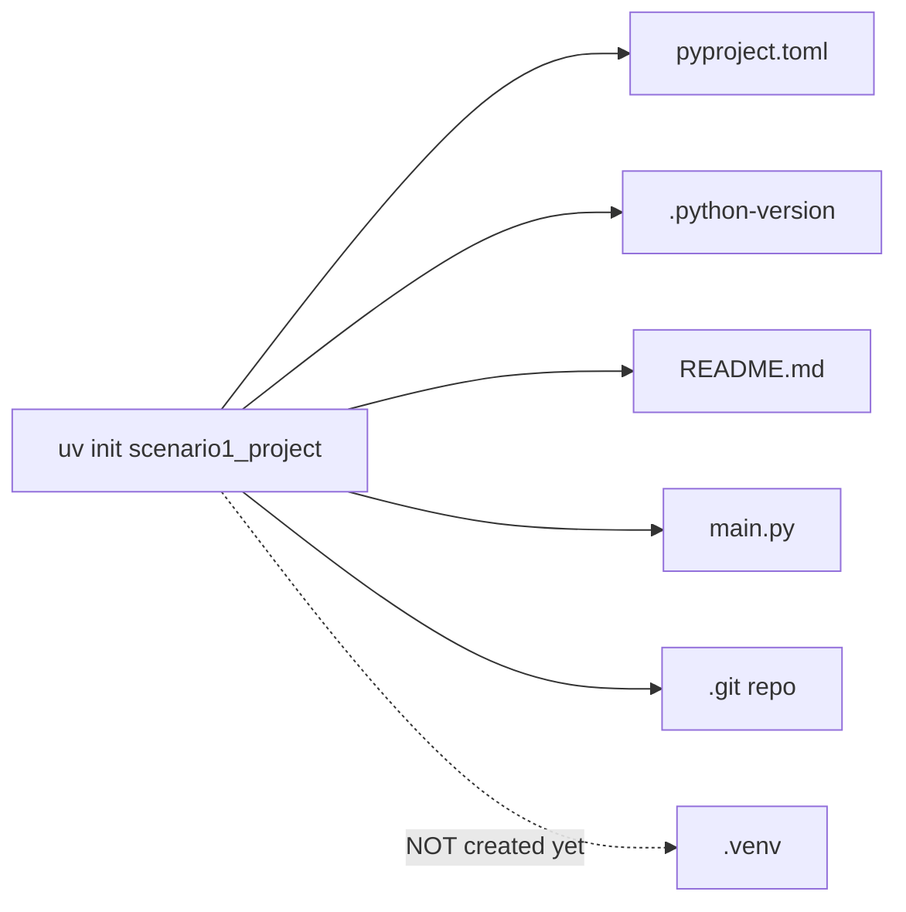
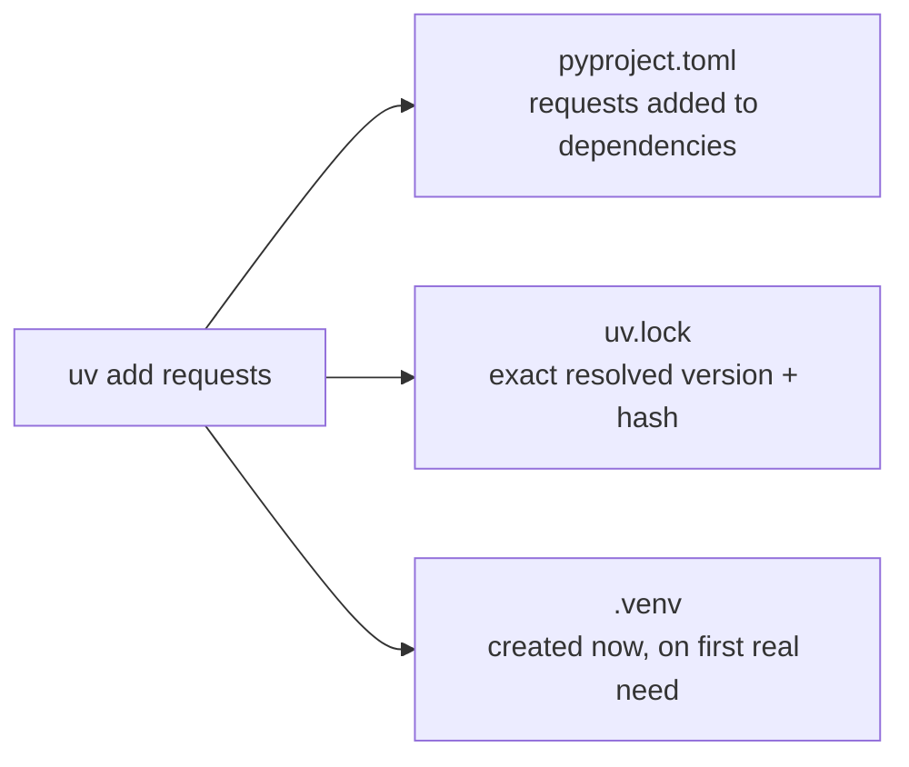
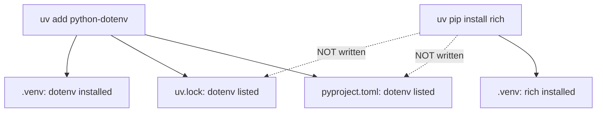
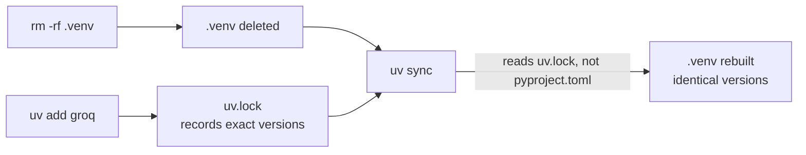
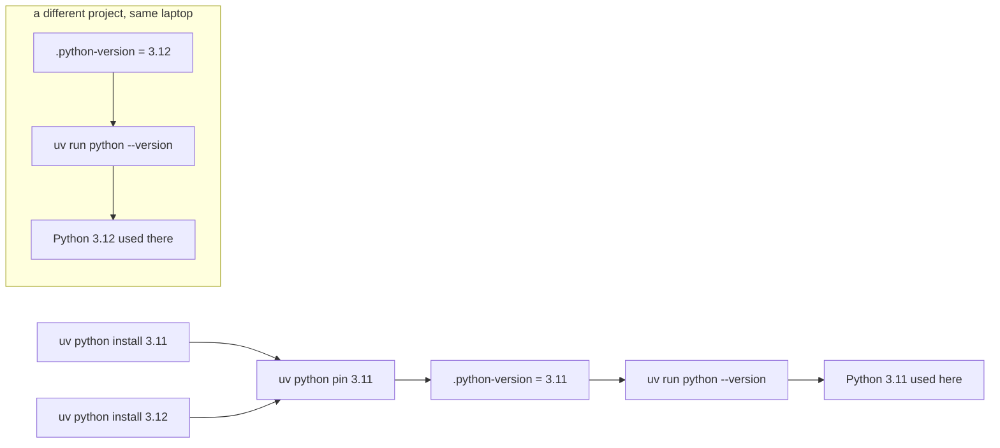
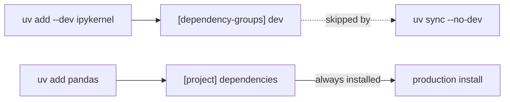
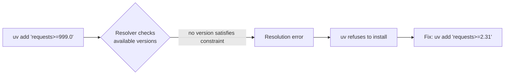

# uv Practice Scenarios

Hands-on terminal exercises to build real muscle memory with `uv`, before you've
written a single line of Python for this course. Each scenario is: do this,
predict what happens, then check the "What you should see" section to confirm.

No Python knowledge needed — just a terminal and `uv` installed (see `01_setup.md`).

---

## Scenario 1: What does `uv init` actually create?

```bash
uv init scenario1_project
cd scenario1_project
ls -a
cat pyproject.toml
```

**Predict first**: how many files do you think `uv init` creates, and is there a
`.venv` folder yet?

**What you should see**: `pyproject.toml`, a `.python-version` file, a `README.md`,
a starter `main.py` (or `hello.py` depending on version), and a `.git` repo — but
**no `.venv` folder yet**. `uv init` only scaffolds the project; it doesn't
install anything until you actually need an environment.

**Why this matters**: this is different from tools that create a venv
immediately on init. `uv` stays lazy — no wasted disk space or install time
until you actually run or add something.



---

## Scenario 2: Watch `uv add` touch three things at once

```bash
uv add requests
cat pyproject.toml
cat uv.lock | head -20
ls -a
```

**Predict first**: which files change when you run one `uv add` command?

**What you should see**: `pyproject.toml` gains `requests` under `dependencies`,
`uv.lock` appears (or grows) with the *exact* resolved version and hash, and
now `.venv` finally shows up too — created on first real need, not at `init`.

**Why this matters**: `pyproject.toml` says "what I need" (flexible, e.g.
`requests>=2.31`), `uv.lock` says "exactly what got installed" (pinned, with
hashes). Two files, two jobs — one for humans to read, one for machines to
reproduce exactly.



---

## Scenario 3: `uv add` vs `uv pip install` — the trap

```bash
uv add python-dotenv
cat pyproject.toml   # dotenv is listed here

uv pip install rich
cat pyproject.toml   # is rich listed here too?
```

**Predict first**: will `rich` show up in `pyproject.toml` the same way
`python-dotenv` did?

**What you should see**: `python-dotenv` is in `pyproject.toml` (and `uv.lock`).
`rich` is installed into `.venv` — you can `uv run python -c "import rich"` and
it works — but it's **not** written into `pyproject.toml` or `uv.lock` at all.

**Why this matters**: `uv pip install` is a low-level escape hatch that behaves
like plain `pip` — it doesn't update your project's declared dependencies. If a
teammate clones your repo and runs `uv sync`, they will **not** get `rich` —
only what's actually declared in `pyproject.toml`. Always prefer `uv add` for
anything your project actually depends on.



---

## Scenario 4: Reproducibility — delete and rebuild from the lock file

```bash
uv add groq
rm -rf .venv
uv sync
uv pip list
```

**Predict first**: after deleting `.venv` entirely, will `uv sync` reinstall
the *same* versions of everything, or could it pick different ones?

**What you should see**: the exact same versions come back, because `uv sync`
reads `uv.lock`, not `pyproject.toml`, when a lock file already exists. It
doesn't re-resolve versions from scratch — it replays the exact resolution
that was already recorded.

**Why this matters**: this is the whole point of a lock file. "Works on my
machine" becomes "works on every machine" — a teammate cloning your repo and
running `uv sync` gets byte-identical dependency versions to you, not
whatever the latest compatible versions happen to be on the day they install.



---

## Scenario 5: Pinning a Python version per project

```bash
uv python install 3.11
uv python install 3.12
uv python pin 3.11
cat .python-version
uv run python --version
```

Now, without changing directories, imagine a *different* project on your
machine pinned to 3.12. Each project would report a different `python
--version` output when you `uv run` inside it — even on the same laptop, at
the same time.

**Why this matters**: `.python-version` makes the interpreter choice part of
the *project*, not a global machine setting. You (or a teammate) can have five
projects on one laptop, each on a different Python version, with zero manual
switching — `uv run` just reads the file and uses the right one.



---

## Scenario 6: Dev dependency vs regular dependency

```bash
uv add --dev ipykernel
uv add pandas
cat pyproject.toml
```

**Predict first**: will `ipykernel` and `pandas` land in the same place in
`pyproject.toml`?

**What you should see**: `pandas` under `[project] dependencies`, `ipykernel`
under a separate `[dependency-groups] dev` (or similar) section.

**Why this matters**: `pandas` is something your *code* needs to run in
production. `ipykernel` is something *you* need to run notebooks while
developing — nobody deploying this project to a server needs a Jupyter
kernel installed. Keeping them separate means a production install
(`uv sync --no-dev`) can skip dev-only tooling entirely.



---

## Scenario 7: Break it on purpose — an unsatisfiable dependency

```bash
uv add "requests>=999.0"
```

**Predict first**: what do you think `uv` will do — install anyway with a
warning, silently install the closest version, or refuse?

**What you should see**: `uv` refuses and prints a resolution error
explaining that no version of `requests` satisfies `>=999.0` (since that
version doesn't exist).

**Why this matters**: `uv` fails loudly and immediately at the exact command
that caused the problem, rather than silently installing something
unexpected or failing later in a confusing way when you actually try to
import the package. Fix it: `uv add "requests>=2.31"` and re-run.



---

## Reflection questions

1. In Scenario 3, `uv add` writes to `pyproject.toml` so the dependency is
   remembered forever. `uv pip install` does NOT — the package disappears
   from the project's "memory" the moment someone re-runs `uv sync`. Given
   that, why would anyone ever want to use `uv pip install`? Try to think of
   one real situation where you'd *want* something installed temporarily,
   without it becoming a permanent project dependency.
   (Example: you're debugging and want to quickly try `import rich` in this
   same environment just to see what a library does — you're not sure you'll
   even keep it. Would you want that curiosity-driven install to permanently
   change your project's dependency list?)
2. In Scenario 4, what would have happened if you'd deleted `uv.lock` itself
   (not just `.venv`) before running `uv sync` — would you still get the
   exact same versions back, or could they drift?
3. Scenario 5 shows Python-version pinning is per-project. Why is that more
   useful for a laptop with many different course/client projects on it than
   a single global "the machine's Python version" setting would be?

## Home Work
- install vscode , uv in your local system
- create an aws account for yourself
- get groq,open weather, tavily api key
- create an github account
- just know about kubernetes