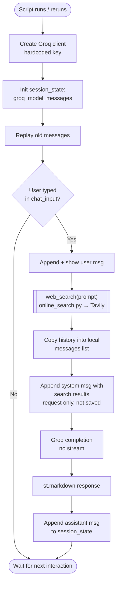

# 2_app_search.py: chat + Tavily web search

Pick this when: you want to show how search results are fed to the model. Key is hardcoded.

Note: this file calls `web_search(prompt)` with one argument, but `online_search.py` now needs `(query, api_key)`. It fails as-is (see README, Known issues).

