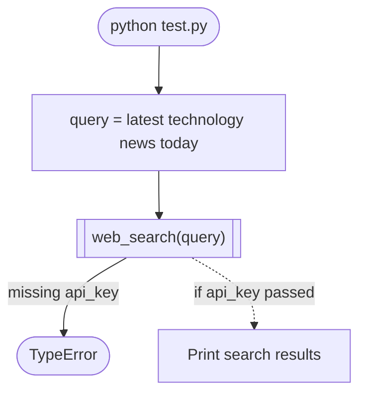

# test.py: quick check of the search helper

Pick this when: you want to test Tavily alone, without Streamlit. Run with `uv run python test.py`.

Note: it calls `web_search(query)` with one argument, but the helper needs `(query, api_key)`. It raises a TypeError as-is.

