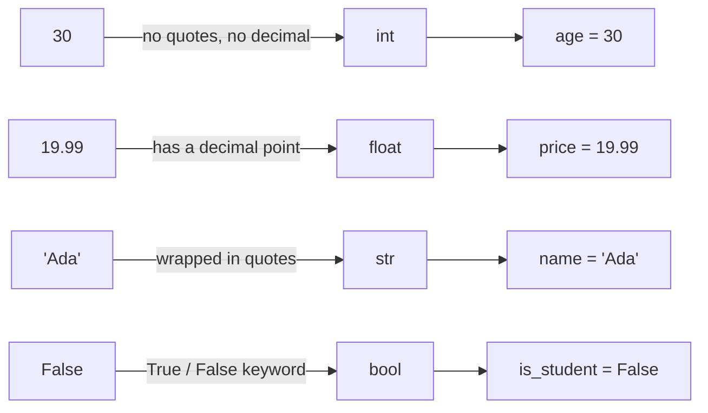

# 01 — Variables and Types: Picture It

**Excalidraw sketch (draw this live)**: Draw 4 boxes side by side, like shipping
crates on a shelf. Label each box with a variable name on a sticky note on top
(`age`, `price`, `name`, `is_student`). Inside each box, draw what it's actually
holding: a tally-mark counter in `age`'s box, a price tag in `price`'s box, a
scroll/paper in `name`'s box, and a light switch (on/off) in `is_student`'s box.
Underneath each box, write its type in a different color (`int`, `float`, `str`,
`bool`) — and add a small arrow from the box's *contents* to that type label,
to show the type comes from what's inside, not from the box itself.

**Mermaid diagram (the mechanics)**:

**AI image prompt (paste into ChatGPT / Gemini)**:
> A friendly warehouse scene with four labeled wooden storage crates on a shelf,
> each crate clearly labeled with a nametag: "age", "price", "name",
> "is_student". Crate "age" contains a stack of numbered counting tokens. Crate
> "price" contains a price tag with a dollar amount. Crate "name" contains a
> scroll with a name written on it. Crate "is_student" contains a simple
> lightswitch in the ON position. A cheerful warehouse robot is scanning each
> crate with a handheld scanner, and a small speech bubble above each scan
> shows the crate's type — a number icon, a dollar icon, a text icon, and a
> toggle icon respectively. Bright, clean, minimal illustration style, no text
> other than the labels described.

**The story → the tech**: A new shipment robot rolls into the warehouse and
sees four crates it's never seen labeled before. It doesn't need a manifest
telling it "this crate holds numbers, this one holds text" — it just opens
each crate, looks at what's *actually inside*, and figures out the type for
itself on the spot. That's exactly what Python does with `age = 30`: you never
declared `age` as an `int` anywhere — Python looked at the value `30`, saw it
had no decimal point and no quotes, and decided `int` right then, the same way
the robot decides just by looking inside the crate. The crate's *name*
(`age`) is the variable; what's physically sitting inside it (`30`) is the
value; and the type is never written on the crate itself — it's inferred
fresh from the contents, every time.
