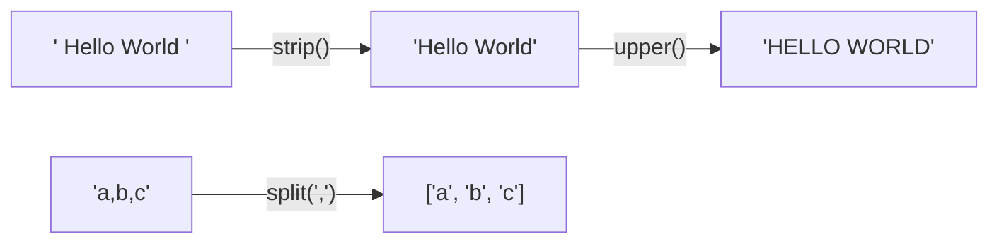

# 02 — Strings: Picture It

**Excalidraw sketch (draw this live)**: Draw a messy, wrinkled strip of paper
with extra blank space on both ends, with the text "  hello world  " scrawled
on it in lowercase, sloppy handwriting. Draw an arrow to a second, identical
strip that's been ironed flat (no wrinkles, no extra space at the ends) with
the text re-written neatly in UPPERCASE: "HELLO WORLD". Then draw a pair of
scissors cutting that flat strip at the space, producing two separate labeled
strips: "HELLO" and "WORLD". Label the ironing step `.strip()`, the
case-change step `.upper()`, and the cutting step `.split()`.

**Mermaid diagram (the mechanics)**:

Each arrow hands back a brand-new string — the original never changes,
which is why the chain `.strip().upper().split(" ")` can run left to right.

**AI image prompt (paste into ChatGPT / Gemini)**:
> A three-panel comic strip. Panel 1: a wrinkled, crumpled paper banner with
> sloppy lowercase text "hello world" and extra blank space on both ends,
> looking messy. Panel 2: the same banner now perfectly ironed flat and
> rewritten in bold neat uppercase "HELLO WORLD," with a small iron icon
> between panel 1 and 2. Panel 3: a pair of scissors cutting the flat banner
> exactly at the gap between the two words, producing two separate clean strips
> "HELLO" and "WORLD" side by side. Clean, minimal flat illustration style,
> bright and simple, no extra text beyond what's described.

**The story → the tech**: A banner arrives from the printer crumpled and
inconsistent — extra space around the edges, careless lowercase lettering.
Before it can be displayed anywhere, someone irons it flat and reprints it in
uppercase so it actually looks presentable, then cuts it into separate pieces
wherever there's a gap. That's `"  hello world  ".strip().upper().split(" ")`
step by step: `.strip()` is the ironing (removes the wasted space at the very
ends, not in the middle), `.upper()` is the reprint in a consistent case, and
`.split(" ")` is the scissors — cutting one long strip into a list of smaller
ones wherever the separator character appears. None of these steps change the
*original* banner sitting in the printer tray — each one hands back a brand
new strip, which is why chaining them (`.strip().upper()`) works: each method
returns a fresh string for the next method to act on.
