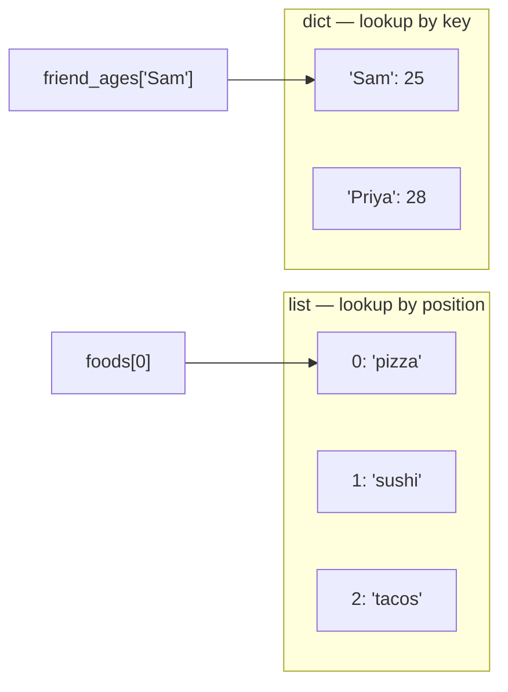

# 03 — Lists and Dicts: Picture It

**Excalidraw sketch (draw this live)**: On the left, draw a numbered coat-check
rack with 3 numbered hooks (0, 1, 2 — start at 0!), each hook holding one
labeled item ("pizza," "sushi," "tacos"). Label this "list — find by NUMBER."
On the right, draw a wall of labeled cubby-holes/mailboxes, each with a NAME
plate instead of a number ("Sam," "Priya"), each cubby holding a folded note
with an age written on it. Label this "dict — find by NAME." Draw a big
divider line down the middle between the two drawings to emphasize they're
two different lookup strategies for the same idea: "a bunch of things in one
container."

**AI image prompt (paste into ChatGPT / Gemini)**:
> A split illustration divided by a vertical line. Left half: a coat-check
> rack at a restaurant with three numbered hooks labeled 0, 1, and 2, each
> hook holding a food item — a pizza slice, a sushi roll, and a taco. A small
> sign above reads "find by number." Right half: a wall of labeled personal
> mailboxes at an apartment building, each mailbox with a nameplate reading a
> person's name, each containing a letter. A small sign above reads "find by
> name." Clean flat illustration style, warm colors, no extra text beyond
> what's described.

**The story → the tech**: At a restaurant coat check, you get ticket #1 and
that's the ONLY way to get your coat back — you point at hook 1, not "the coat
with the red lining." That's a **list**: `foods[1]` finds something purely by
its position, counting from 0. At an apartment building, nobody remembers "the
mailbox in the third row" — they walk up and look for the nameplate that says
"Sam." That's a **dict**: `friend_ages["Sam"]` finds something by a
meaningful key, not a position. The two aren't interchangeable: if the
restaurant lost the numbered tickets and tried to find your coat by name
instead, the whole system breaks — which is exactly why choosing between a
list and a dict up front matters, based on whether you'll naturally be
looking things up by position or by name.

**Mermaid diagram (the mechanics)**:

