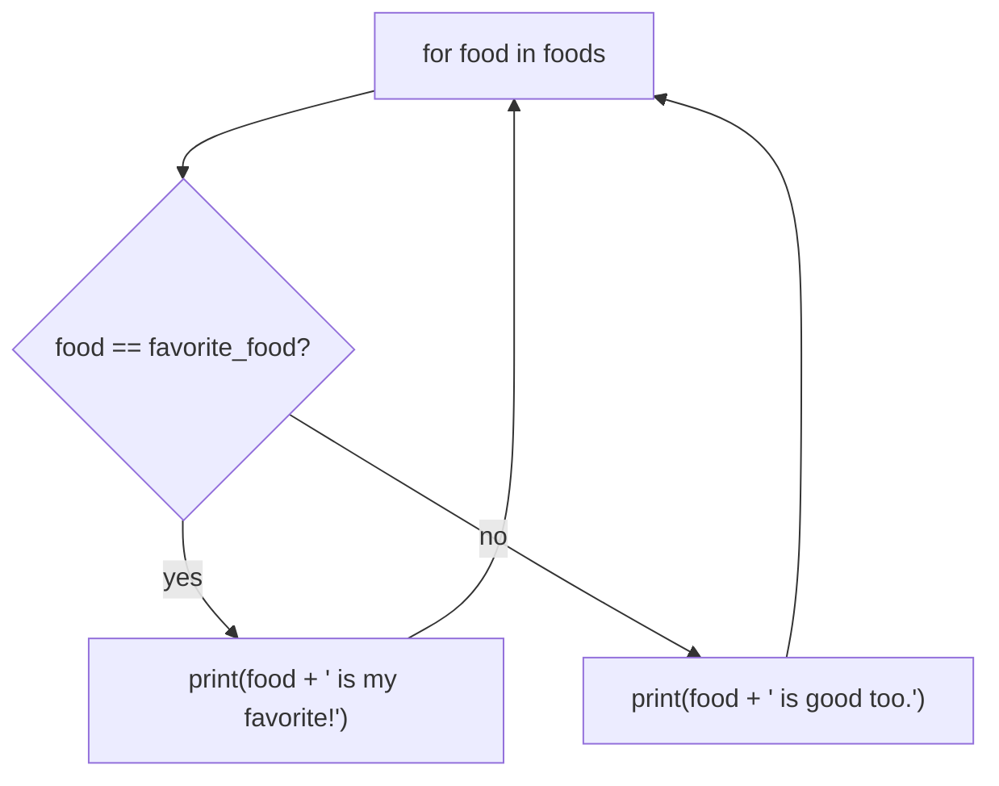
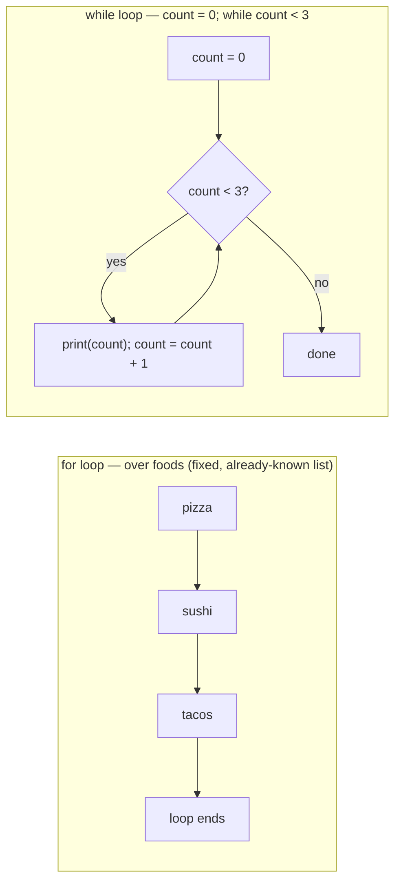

# 04 — Conditionals and Loops: Picture It

**Excalidraw sketch (draw this live)**: Draw a fork in a road with 3 signposts
branching off it, labeled "if score >= 90 -> A street," "elif score >= 80 ->
B street," "else -> F street." Draw a little traveler standing at the fork
who checks each signpost IN ORDER, top to bottom, and walks down the FIRST
road whose condition is true, ignoring the rest. Next to it, draw a separate
loop-the-loop track: a `for` loop as a train that stops at every station on a
fixed, already-known list of stations (draw 3 stations), versus a `while`
loop as a car circling a roundabout that keeps going around and around until
a specific exit sign lights up green — and if that sign never lights up, draw
the car still circling off the edge of the page, to show an infinite loop.

**AI image prompt (paste into ChatGPT / Gemini)**:
> A road-trip themed illustration. Left side: a fork in a road with three
> signposts branching off, labeled "score 90+", "score 80+", "else", with a
> small character standing at the fork looking at the signs in order from top
> to bottom, currently walking down the first matching path. Right side, split
> into two: a toy train stopping at three fixed labeled stations in a row
   (labeled "for loop — visits each stop once"), and below it a car driving in
> circles around a roundabout with an exit sign that is currently red/unlit
> (labeled "while loop — keeps going until a condition turns green"). Clean
> flat illustration style, bright colors, no extra text beyond what's
> described.

**The story → the tech**: At a fork with three signposts, a traveler doesn't
check all three and then decide — they check the FIRST one, and if it's true,
they walk that way and never even glance at the rest. That's `if`/`elif`/
`else`: Python checks each condition top to bottom and stops at the first
match, exactly like the traveler ignoring the other two signs once they've
committed to a road. The train and the roundabout show the other half: a
`for` loop is like a train with a fixed list of stations already known ahead
of time — it visits each one exactly once and then it's done. A `while` loop
is like a car circling a roundabout with no fixed number of laps — it keeps
going as long as its exit condition stays red, and if nothing inside the loop
ever turns that light green (like forgetting `count = count + 1`), the car
circles forever. That "green light" is also where `=` vs `==` bites people:
writing `count = 3` inside a condition check *assigns* 3 to count instead of
*asking* "is count equal to 3?" — like repainting the exit sign green instead
of checking whether it's already green.

**Mermaid diagram (the mechanics)**:

