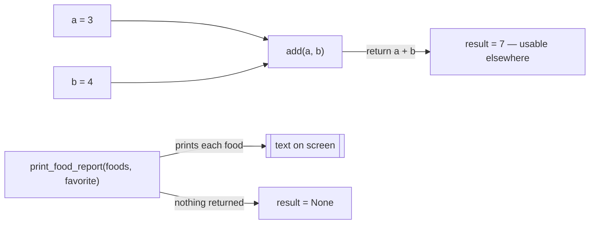

# 05 — Functions: Picture It

**Excalidraw sketch (draw this live)**: Draw a vending machine box labeled
`add(a, b)`. Draw two coin slots on top labeled `a` and `b`, and a dispenser
slot at the bottom labeled `return`. Show coins going in (e.g. "3" and "4")
and a candy bar labeled "7" coming out the dispenser slot — that candy bar can
then be handed to a person standing nearby (a variable storing the result).
Next to it, draw a SECOND machine labeled `print_food_report(...)` with no
dispenser slot at all — just a little megaphone on the side announcing things
out loud into the air, with nothing physical coming out the bottom. Label the
megaphone machine "print only — nothing to hand to anyone."

**AI image prompt (paste into ChatGPT / Gemini)**:
> Two vending machines side by side in a simple flat illustration style. The
> left machine is labeled "add(a, b)" with two coin slots on top labeled "a"
> and "b", coins showing "3" and "4" being inserted, and a dispenser tray at
> the bottom releasing a candy bar labeled "7" into a customer's open hand. The
> right machine is labeled "print_food_report(...)" with the same coin slots,
> but instead of a dispenser tray it has a megaphone on top shouting speech
> bubbles into the air, and its dispenser tray is sealed shut with an "X".
> Bright, clean, minimal illustration style, no extra text beyond what's
> described.

**The story → the tech**: A vending machine takes specific inputs (coins in
the right slots) and, critically, hands you something back through the
dispenser that you can walk away with and use elsewhere — buy something else
with it, split it with a friend, whatever. That handoff is exactly what
`return` does: `add(3, 4)` hands back `7`, and you can store that `7` in a
variable and keep using it. The megaphone machine is the trap: it takes the
same inputs and does something (shouts them out loud, i.e. `print`s them),
but nothing physical comes out the dispenser — if you try to grab "what the
machine gave you," your hands close on nothing (`None`). That's why
`result = print_food_report(...)` gives you `None` instead of anything
useful: `print` announces, it doesn't dispense. Wrapping repeated logic in a
function is like building ONE vending machine instead of a separate ad-hoc
setup every time someone wants a candy bar — same machine, reusable with
different coins (`add(10, 20)`, `add(100, 1)`) without rebuilding it.

**Mermaid diagram (the mechanics)**:

