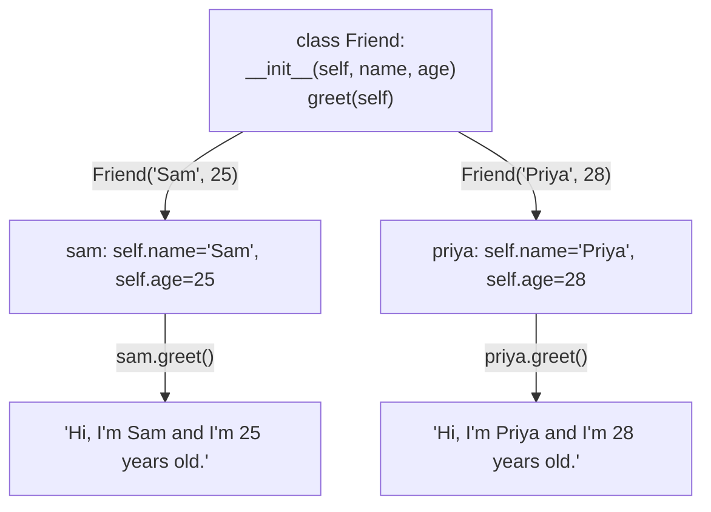

# 06 — Classes: Picture It

**Excalidraw sketch (draw this live)**: Draw a plain index card with just two
lines written on it: "Name: Sam" and "Age: 25" — label this "a dict: just
data, nothing it can DO." Next to it, draw a small robot figure with a name
tag "Sam" pinned to its chest and an age "25" stamped on its arm, and give the
robot a speech bubble mid-`greet()`: "Hi, I'm Sam and I'm 25!" Label the robot
"a class instance: data (name/age) + behavior (greet) bundled into ONE
thing." Draw a dotted "blueprint" box behind the robot labeled `class Friend`
with `__init__` and `greet` written inside it, and an arrow from the blueprint
to the robot labeled "self = this specific robot."

**AI image prompt (paste into ChatGPT / Gemini)**:
> A side-by-side illustration. Left: a plain white index card lying flat with
> handwritten text "Name: Sam, Age: 25", nothing else happening around it.
> Right: a small friendly robot character with a nametag reading "Sam" and a
> number "25" stamped on its arm, actively speaking with a speech bubble that
> says "Hi, I'm Sam!" Behind the robot, a faint dotted blueprint/schematic
> outline of the same robot labeled with small gear icons, showing where the
> robot's design came from. Clean, minimal flat illustration style, friendly
> and simple, no extra text beyond what's described.

**The story → the tech**: An index card can hold "Name: Sam, Age: 25," but it
just sits there — it can't introduce itself, it can't do anything with its
own information. A robot built from a blueprint has the SAME data (a name
tag, an age stamp) but can also act on that data — it can walk up and
introduce itself using what's written on its own tag. That's the entire
difference between a dict (`{"name": "Sam", "age": 25}` — data only) and a
class (`Friend("Sam", 25)` — data *and* behavior, bundled together). The
dotted blueprint is `class Friend:` itself — a design that hasn't built
anything yet. `__init__` is the assembly step that stamps the name tag and
age onto a brand new robot the moment it's built (`sam = Friend("Sam", 25)`).
And `self` is just "whichever specific robot is currently talking" — when
`priya.greet()` runs, `self` refers to Priya's robot, not Sam's, even though
both robots were built from the exact same blueprint.

**Mermaid diagram (the mechanics)**:

