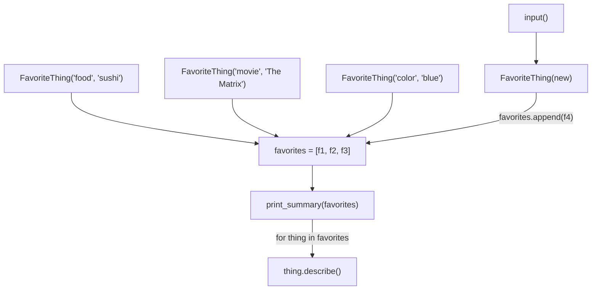

# 07 — Mini Project: Picture It

**Excalidraw sketch (draw this live)**: Draw a small shelf holding three of
the little robot figures from notebook 06's sketch, each with a different
nametag: "food: sushi," "movie: The Matrix," "color: blue." Next to the shelf,
draw the vending-machine box from notebook 05 labeled `print_summary(things)`
— but this time its input slot has an arrow sweeping across ALL three robots
on the shelf one at a time (a loop), and its megaphone speaks each robot's own
`describe()` line out loud in sequence. Finally, draw a fourth, empty robot
shell being wheeled in from an "input()" doorway on the side, about to be
placed on the shelf next to the others.

**AI image prompt (paste into ChatGPT / Gemini)**:
> A cozy illustration of a wooden shelf holding three small friendly robot
> figures in a row, each with a different nametag: "sushi," "The Matrix,"
> "blue." Beside the shelf, a vending-machine-style box labeled
> "print_summary" with a mechanical arm sweeping across the three robots one
> at a time, and a megaphone on top of the machine with three sequential
> speech bubbles, one per robot. On the far right, a doorway labeled "input()"
> with a fourth, empty robot shell being wheeled in on a small cart, about to
> join the shelf. Clean, warm, minimal flat illustration style, no extra text
> beyond what's described.

**The story → the tech**: This mini-project is just the earlier chapters
sharing one shelf. Each `FavoriteThing` is one of notebook 06's little
robots — data (`category`, `name`) plus behavior (`describe()`) bundled
together. The shelf itself is notebook 03's list (`favorites = [...]`),
holding several robots in order. `print_summary` is notebook 05's vending
machine again, except this time its "coin slot" accepts the *whole shelf* at
once and it loops over every robot on it (notebook 04's `for` loop),
asking each one to announce itself in its own words. And the new part —
`input()` wheeling in a fourth robot — is exactly what it looks like: you
build a brand new `FavoriteThing` from typed-in text, `append()` it onto the
existing shelf, and the SAME `print_summary` machine, unchanged, now
includes it automatically the next time it sweeps across the shelf. Nothing
about the machine needed to change to handle a bigger shelf — that's the
payoff of building it as a reusable function in the first place.

**Mermaid diagram (the mechanics)**:

