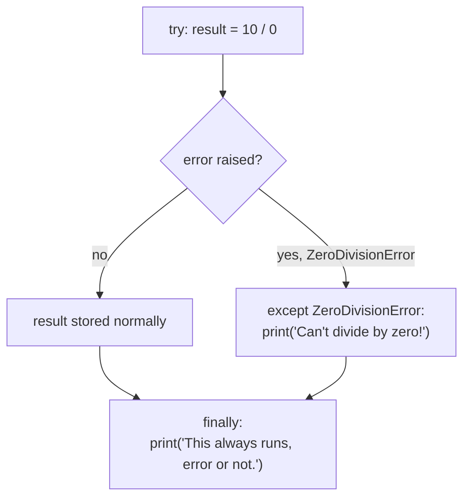

# 08 — Try / Except: Picture It

**Excalidraw sketch (draw this live)**: Draw a tightrope walker labeled `try:`
walking across a rope over a pit. Below the rope, draw a big safety net
labeled `except ValueError:` — if the walker slips (draw a little "slip!"
motion line), they fall safely INTO the net instead of hitting the pit floor,
and the program keeps going instead of ending. Off to the side, draw a
stagehand labeled `finally:` who walks out and sweeps the stage EVERY single
time the act ends — whether the walker crossed safely or fell into the net —
to show `finally` runs no matter what.

**AI image prompt (paste into ChatGPT / Gemini)**:
> A circus scene: a tightrope walker labeled "try" mid-step on a rope stretched
> over a pit. Below the rope, a safety net labeled "except" is stretched out,
> currently catching the walker who has just slipped off the rope, safely
> suspended in the net instead of falling further. To the side of the stage, a
> stagehand labeled "finally" is sweeping the stage floor with a broom,
> depicted as always present regardless of the walker's outcome. Bright circus
> illustration style, clean and simple, no extra text beyond what's described.

**The story → the tech**: A tightrope walker without a net has one bad slip
and the show is over — that's a program with no `try/except` hitting
`int("abc")` and crashing entirely. Put a net under the rope (`except
ValueError:`) and a slip becomes a safe, handled moment: the walker (your
code) falls into the net, the audience notices something happened, but the
show continues — `to_int("abc")` prints a friendly message and returns `None`
instead of crashing. Crucially, the moment the walker starts falling, the
REST of that specific step across the rope never happens — same as how code
written after the failing line inside `try` never runs; execution jumps
straight to the net (`except`). And the stagehand sweeping up is `finally`:
they walk out and do their job whether the walker crossed safely or fell into
the net — same idea as always closing a file or cleaning up a resource,
success or failure.

**Mermaid diagram (the mechanics)**:

