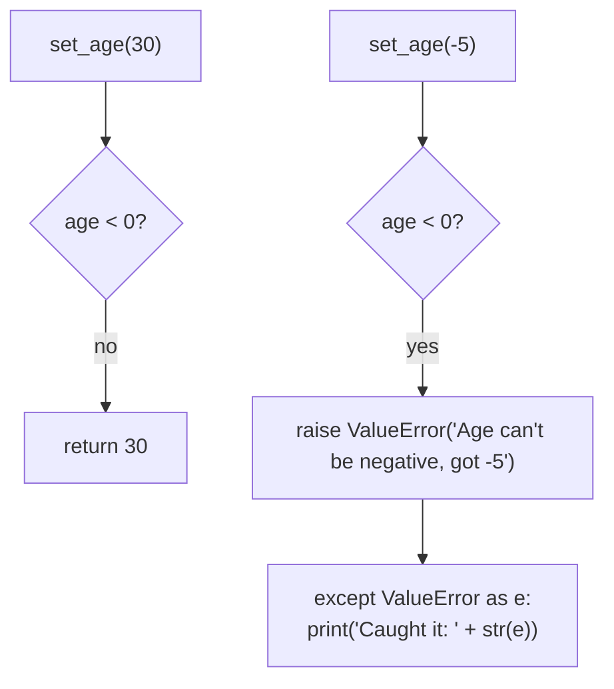

# 09 — Raise: Picture It

**Excalidraw sketch (draw this live)**: Draw a security guard standing at a
door labeled `set_age(age)`, holding up a big red STOP sign the moment
someone tries to walk through carrying a box labeled "-5" (a negative age).
The guard doesn't quietly wave them through with a shrug — draw a speech
bubble from the guard: "ValueError: Age can't be negative, got -5" — and a
clear "NO ENTRY" line the visitor cannot cross. Off to the side, draw a
SEPARATE person (the caller) standing behind a "try/except" booth with a
catcher's mitt, ready to catch whatever the guard throws out, so the whole
building doesn't need to shut down over one bad visitor.

**AI image prompt (paste into ChatGPT / Gemini)**:
> A security checkpoint illustration. A guard character labeled "set_age"
> stands at a doorway, one hand raised showing a red STOP sign, blocking a
> visitor who is holding a box labeled "-5". A speech bubble from the guard
> reads "Age can't be negative!" A clear red line on the floor marks a
> boundary the visitor cannot cross. To the side, a second small booth labeled
> "try/except" has a person standing behind it holding open a catcher's mitt,
> ready to catch something thrown their way, looking calm and prepared rather
> than alarmed. Clean flat illustration style, no extra text beyond what's
> described.

**The story → the tech**: A security guard who just shrugs and lets bad
input through (silently returning `None` for a negative age) creates a
problem for someone ELSE, much later, deep inside the building, who has no
idea a negative age ever got in. A guard who stops it right at the door and
says exactly what's wrong (`raise ValueError(f"Age can't be negative, got
{age}")`) fails loudly, at the source, with a clear reason — that's the whole
argument for `raise` over quietly returning `None`. And the guard doesn't
personally decide what happens to a rejected visitor — that's the
`try/except` booth's job. The guard's only responsibility is to refuse
clearly; whoever's watching from behind the `try/except` booth decides
whether to catch it gracefully (print a message) or let it end the show
entirely. Same exception type, same catching mechanism as notebook 08 — the
only difference is WHO threw it: Python itself, or your own `raise`.

**Mermaid diagram (the mechanics)**:

