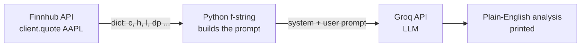

# MarketPlus AI: why we build this

A client story to show how a Forward Deployed Engineer (FDE) thinks. An FDE is an engineer who sits with the client, understands the real problem, and builds the first working solution.

## The client's problem

MarketPlus is a small advisory firm. Every morning, customers message their advisors:

> "How is Apple doing today? Should I worry?"

For each message, an advisor opens a stock site, reads a handful of numbers, and types two or three plain sentences back. It takes a few minutes each, and it is the same job every time.

The ask: **"Can a computer write the first draft of that answer?"**

## Think in order

### Step 1. Where do the numbers come from?
Typing prices by hand is out. We need live data, and live data comes from an **API**: a web address your Python code can call and get data back. Finnhub gives stock quotes.

The call returns a dict you already know how to read:

| Field | Meaning |
|---|---|
| `c` | current price |
| `d` | change from previous close |
| `dp` | percent change |
| `h` / `l` | day's high / low |
| `o` | opening price |
| `pc` | previous close |

So far this is just Python: call a function, get a dict, read keys.

### Step 2. Can plain Python write the sentence?
Try it with rules:

```python
if quote["dp"] < 0:
    print("Apple is down today.")
else:
    print("Apple is up today.")
```

It works, but it is thin. What about "down 1.5%, but it opened high and is near the day's low, is that bad?" Every new case needs a new rule, and the output sounds like a machine.

### Step 3. What would we do with a smart human?
We would hand them the numbers and say: *"You are a market analyst. Explain this to a customer."*

That is what a **Large Language Model (LLM)** does: it reads text and writes text. Picture a smart intern working in a room with no windows:

- They read and write well.
- They know nothing about today. No news, no prices.
- If it is not on the paper you hand them, they do not know it.

### Step 4. So the job has three parts
1. Get fresh numbers (Finnhub API).
2. Put those numbers on the paper (a **prompt**).
3. Hand the paper to the intern (Groq API, running the model).

### Step 5. Write the paper
A prompt has two parts:
- **System prompt:** who the model should be. `"You are a stock market analyst."`
- **User prompt:** the task and the data. An f-string drops the live numbers in.

Putting live data into the prompt like this is called **context injection**.

### Step 6. Keep keys out of the code
Both APIs need a key. In Colab we read them from `userdata` (the padlock icon), so no key sits in the notebook.

## What the notebook does



Cell by cell in [Finhub.ipynb](Finhub.ipynb):
1. Install `finnhub-python` and `groq`.
2. Load both keys from Colab secrets.
3. Fetch the AAPL quote and print price and change.
4. Build the prompt from the quote, send it to Groq, print the answer.

## What to notice

- **The model never looked up the price.** We fetched it and handed it over. This is the key idea of the project.
- **This is zero-shot prompting:** we gave no example of a good answer. The notebook's table lists what to try when the answer is not good enough: role prompting, one-shot, few-shot, chain-of-thought.
- **It can sound sure and still be wrong.** Check numbers against the quote, and treat the output as a draft for an advisor, not financial advice.

## Try it yourself
- Change `"AAPL"` to another ticker.
- Change the system prompt to `"You explain markets to a beginner in two sentences."` and compare.
- Add one example answer to the prompt (one-shot) and see how the style changes.

## Why the next project (05)
Here the data was a small flat dict, and we chose which 4 fields to send. Real APIs return big, nested data, and calls fail. [05_Weather_Wisper_Project](../05_Weather_Wisper_Project/README.md) builds the same recipe more slowly, with messier data.
