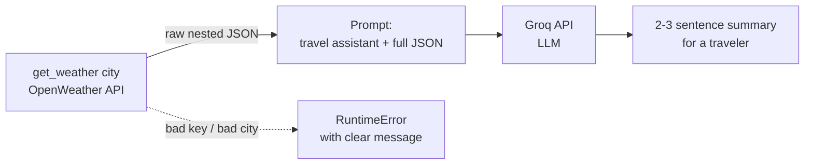
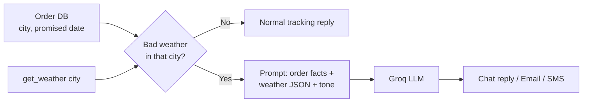

# WeatherWhisper: why we build this after MarketPlus

Another client story, told the way a Forward Deployed Engineer (FDE) would work through it. Read [04_MarketPlusAI_Finhub](../04_MarketPlusAI_Finhub/README.md) first if you have not.

## The client's problem

A travel-booking startup sends every customer an itinerary email: "Paris, 3 days". Customers keep replying with the same question:

> "What's the weather like? What should I pack?"

The support team checks a weather site and types an answer by hand. The startup wants a short "weather whisper" in every email: two or three plain sentences saying what today is like and what to bring.

## Why not just reuse 04?

04 proved the recipe: **API data + prompt + LLM**. But it was a clean case:

- The data was a flat dict of 8 fields.
- We picked the 4 fields to send.
- Nothing went wrong.

Real life is messier. Data is nested, keys are not active yet, city names are ambiguous, and calls fail. So 05 builds the recipe slowly, one working piece at a time.

## Think in order

### Step 1. Get the data first, with no AI
If the weather call does not work, no prompt will fix it. An FDE proves each piece on its own before joining them. So the first half of the notebook has no LLM at all, only a call to the OpenWeather API.

Gotcha you will hit: a new API key can take 10 to 15 minutes to activate. A `401` right after signup is normal. Wait and retry.

### Step 2. Read the response
This data is nested: dicts inside dicts, and a list inside the dict.

```python
data["main"]["temp"]            # dict inside a dict
data["weather"][0]["description"]  # list inside a dict, then a dict
```

Things that can trip you up:
- **Units.** The API returns Kelvin unless you add `units=metric`.
- **City names.** "Springfield" resolves to some Springfield. Use `"London,GB"` or latitude/longitude to be exact.

### Step 3. Make failures readable
`get_weather()` checks the status code and raises a clear `RuntimeError` instead of letting you hit a confusing `KeyError` later. This is the `try/except/raise` from your earlier lessons, now doing real work.

### Step 4. Customers do not want JSON
Could plain Python write the message? Something like `if "rain" in description: print("Take an umbrella")`. It starts fine, then grows: wind, humidity, "feels like" versus real temperature, cold and wet together. The rules never end.

An LLM can read all of that at once. You already met it in 04: the intern who reads and writes well but knows nothing about today.

### Step 5. The new idea: hand over the whole mess
In 04 you picked the fields. Here you do not:

```python
Weather data:
{json.dumps(weather_data)}
```

The full raw JSON goes into the prompt, and the model decides what matters to a traveler. The prompt only says who the model is (a travel assistant) and what to write (2 to 3 sentences, plain English).

### Step 6. Control the output
Two settings in the Groq call:
- `temperature=0.3`: lower means steadier, less random wording.
- `max_completion_tokens=200`: keeps the answer short.

### Step 7. Grounding
The model does not know today's weather. It only knows what is in the prompt. Fetching real data first and then asking the model to explain it is called **grounding**, and it is the core of most AI apps.

## What the notebook does



In [WeatherWhisper_API_Demo.ipynb](WeatherWhisper_API_Demo.ipynb):
1. Get an OpenWeather key and store it in Colab secrets.
2. Call the API and print the raw JSON.
3. Pull out fields by hand (temp, feels like, humidity, description).
4. Try other cities.
5. Add a Groq key, then `summarize_weather(city)` joins it all together.

## 04 vs 05 at a glance

| | 04 MarketPlus | 05 WeatherWhisper |
|---|---|---|
| Data | flat stock quote | nested weather JSON |
| Who picks the fields | you (4 fields) | the model (whole JSON) |
| Failure handling | none | `get_weather` raises clear errors |
| Main lesson | prompts and prompting techniques | build in pieces, then ground the model |

## Try it yourself
- Run `summarize_weather("Mumbai")` and compare it with the raw JSON. Is anything it said not in the data?
- Change the prompt to ask for a packing list in bullet points.
- Set `temperature=1.0` and run the same city a few times. What changes?
- Use a wrong city name or a wrong key on purpose and read the error.

## Another use case: "Your order is delayed by weather"
An e-commerce site ships parcels from a warehouse. When a storm hits, customers open the chat and ask:

> "Where is my order? It was due today."

Today, support either says "please wait" or an agent checks the weather and the courier by hand. The shop wants two things:
1. **Chat reply:** answer the customer in the chat, with the real reason.
2. **Proactive message:** email or SMS the customer before they ask.

### Think in order
1. **Get the facts, no AI.** Order data (city, promised date) comes from the shop's own database. Weather for the delivery city comes from `get_weather(city)`, the function you already wrote.
2. **Decide with plain Python.** Whether the order is delayed is a rule, not a writing job. Keep it in code so it is predictable:
   ```python
   weather = get_weather(order["city"])
   bad = weather["weather"][0]["main"] in ("Thunderstorm", "Snow") or weather["wind"]["speed"] > 15
   ```
   The thresholds here are made up. Pick them with the business.
3. **Let the model write the message.** The rule says *that* it is delayed. The model writes *how it sounds*: polite, short, in the customer's context. Pass in the order facts and the weather, as in `summarize_weather`.
4. **Choose the channel.** The same text can go to the chat window, an email, or an SMS. Only the prompt's length and tone instruction change ("under 160 characters" for SMS).



### Sketch of the prompt
```python
prompt = f"""You are a customer support agent for an online shop.
Write a short, polite message (max 3 sentences) telling the customer their order is delayed because of weather.
Do not promise a new delivery date. Do not invent facts.

Order: {order['id']}, going to {order['city']}, originally due {order['due']}.
Weather data:
{json.dumps(weather_data)}
"""
```

### What to watch for
- **Do not let the model decide the facts.** It must not invent a new delivery date, a refund, or a compensation offer. Put only true facts in the prompt and say what not to promise.
- **Keep a human in the loop at first.** Draft the messages, let support review them, and send automatically only after you trust the output.
- **Check the weather at the right place.** Weather in the customer's city is not weather at the warehouse or on the courier's route. Real systems check all of them.
- **Handle failures.** If the weather call fails (the `RuntimeError` from step 3), fall back to a generic "your order is delayed" message instead of sending nothing.

### Try it yourself
- Fake an order dict with a city and due date, and write `delay_message(order)` that reuses `get_weather`.
- Generate the same message for chat (3 sentences) and SMS (under 160 characters).
- Ask the model to promise a new delivery date, then add a rule to the prompt that stops it.
