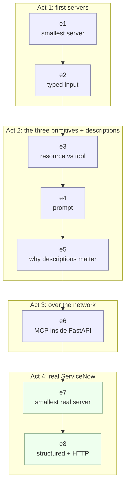
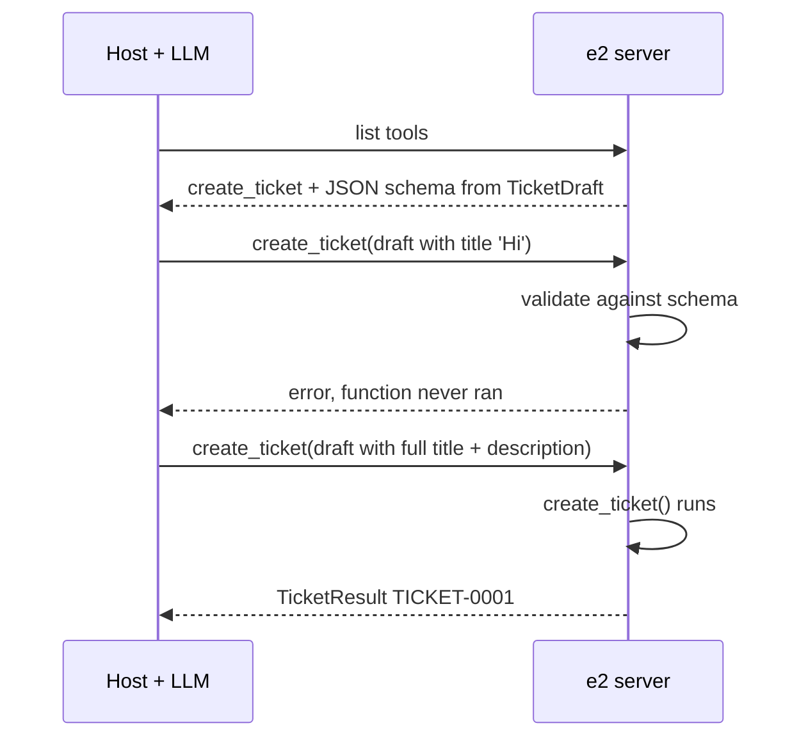
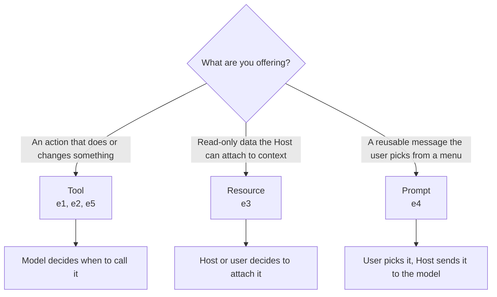
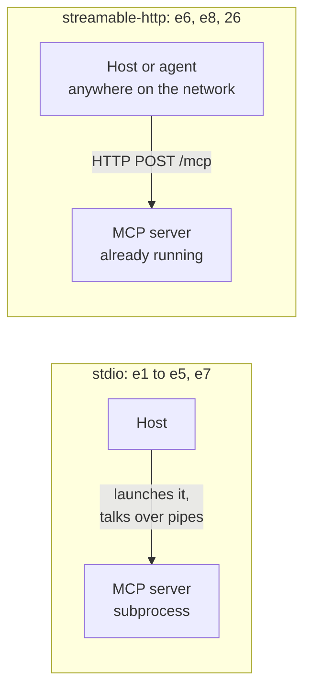
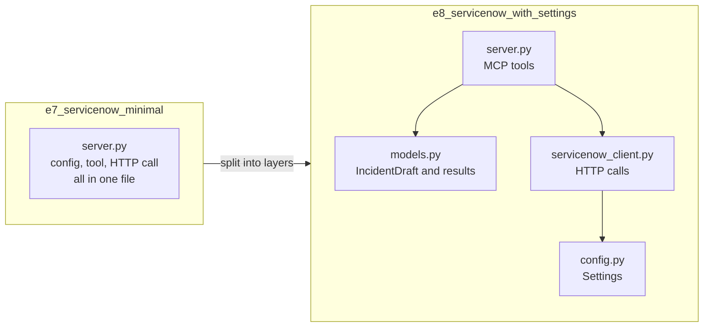

# MCP examples, e1 to e8: a learning path

Eight small servers, meant to be done in order. Each one adds **one** new idea. By e8 you have a real MCP server that talks to ServiceNow.

New to MCP? Read the big-picture story first (the USB analogy, Host / Client / Server): [../README.md](../README.md). This page is the hands-on walk-through.

---

## The story: opening an IT help desk

You run a help desk. People walk up with problems, and you want an assistant (the LLM) to log tickets for them. MCP is how the assistant gets "hands".

| Act | Files | What happens in the story |
|---|---|---|
| **1. Hire a clerk** | e1, e2 | First a clerk who can do one trivial thing. Then you give them a proper ticket form, so they stop writing free text. |
| **2. Teach the clerk three things** | e3, e4, e5 | A notice board they can read (resource). Quick-reply cards (prompt). And a clear label on every button (tool description). |
| **3. Open a window to the building** | e6 | Until now the clerk sat in your own room. Now anyone on the network can walk up. |
| **4. Plug into the real ticket system** | e7, e8 | First the fastest wiring to ServiceNow (e7). Then the proper, maintainable version (e8). |



Blue = fake data, safe to run anywhere. Green = talks to a real ServiceNow instance (you need credentials).

---

## At a glance

| # | File | New idea | One-line takeaway | Transport |
|---|---|---|---|---|
| e1 | [e1_minimal_mcp_server.py](e1_minimal_mcp_server.py) | A server and a tool | An MCP server is a long-running process waiting for a Host, not a script that prints and exits. | stdio |
| e2 | [e2_tool_with_pydantic_schema.py](e2_tool_with_pydantic_schema.py) | Typed input and output | A Pydantic model becomes the tool's schema. Bad input is rejected before your code runs. | stdio |
| e3 | [e3_resource_vs_tool.py](e3_resource_vs_tool.py) | Resource | Same data as a resource (read) or a tool (do). The protocol role is different. | stdio |
| e4 | [e4_prompt_template.py](e4_prompt_template.py) | Prompt | A reusable, parameterised message the Host can offer as a menu item. | stdio |
| e5 | [e5_break_the_description.py](e5_break_the_description.py) | Tool descriptions | Two identical tools, different `description`. The model only knows what you wrote there. | stdio |
| e6 | [e6_fastapi_mounted_mcp.py](e6_fastapi_mounted_mcp.py) | HTTP transport | Mount MCP inside FastAPI. `/mcp` speaks the MCP protocol, it is not a plain REST route. | streamable-http |
| e7 | [../e7_servicenow_minimal/](../e7_servicenow_minimal/README.md) | Real API | One file, one tool: create a real ServiceNow incident. Credentials from `.env`. | stdio |
| e8 | [../e8_servicenow_with_settings/](../e8_servicenow_with_settings/README.md) | Structure | Settings class, models, client class, two tools, over HTTP. The shape you would grow into a real service. | streamable-http |

---

## How to run and check each one

All commands run from `04_Day5_MCP/` (the folder above this one):

```powershell
uv sync
```

**Check any stdio server in the MCP Inspector** (a browser UI that plays the Host):

```powershell
npx @modelcontextprotocol/inspector uv run python 01_examples/e1_minimal_mcp_server.py
```

Swap in the file you want. The Inspector has three tabs, which map to the three primitives: **Tools**, **Resources**, **Prompts**. Which tab shows something is half the lesson.

| File | Open this tab | You should see |
|---|---|---|
| e1 | Tools | `add_numbers` with two integer fields |
| e2 | Tools | `create_ticket` with a `draft` object: title, description, priority |
| e3 | Resources **and** Tools | resource `tickets://schema` and tool `get_ticket_schema`, same data |
| e4 | Prompts | `draft_ticket_from_complaint` with a `complaint` argument |
| e5 | Tools | `create_ticket_good` and `create_ticket_vague`, same code, different descriptions |
| e6 | Tools | `create_ticket`, reached over HTTP (see below) |

e6 is different: start it, then point the Inspector at the URL.

```powershell
uv run uvicorn --app-dir 01_examples e6_fastapi_mounted_mcp:app --port 8000
```

Then in the Inspector pick **Streamable HTTP** and use `http://127.0.0.1:8000/mcp`. `http://127.0.0.1:8000/health` is a normal REST route you can open in a browser.

For e7 and e8 follow their own READMEs (they need ServiceNow credentials in a `.env`).

---

## Act 1: hire a clerk (e1, e2)

### e1: the smallest server
- One `MCPServer`, one tool, `mcp.run()`.
- Notice: running it prints **nothing** and the cursor just sits there. That's correct. It's waiting on stdin for a Host.

<details>
<summary>Predict first: what happens when you run this file?</summary>

Nothing visible. The default transport is stdio, so the process starts and waits for a Host to talk to it over stdin/stdout. Press Ctrl+C to stop it. It's a service, not a CLI tool.
</details>

### e2: give the clerk a form
- `TicketDraft` is a Pydantic model. MCP turns it into a JSON schema and sends it to the Host, so the LLM knows exactly which fields to fill.
- `min_length`, `Field(description=...)` and defaults all become part of the contract.
- Running the file also prints the schema, so you can see what the model sees.

<details>
<summary>Predict first: a Host sends <code>{"title": "Hi"}</code>. Where is it rejected?</summary>

Before your function runs. The server validates the arguments against the schema (the title is too short and `description` is missing) and returns an error. `create_ticket()` is never called. That's why typed models are worth it.
</details>



---

## Act 2: teach the clerk three things (e3, e4, e5)

MCP servers can offer three kinds of things. Pick by asking one question.



### e3: resource vs tool
- The same ticket schema is exposed twice: as a resource (`tickets://schema`) and as a tool (`get_ticket_schema`).
- Same JSON comes back. The difference is *who decides to fetch it*.

<details>
<summary>Predict first: can a Host get the same JSON from both?</summary>

Yes. The difference is the role. A resource is read-only data a Host can list and attach proactively ("always give the model this schema"). A tool only runs when the model chooses to call it. Using a tool for static, never-changing data is the wrong mental model, even though the output is identical.
</details>

### e4: prompt template
- `draft_ticket_from_complaint(complaint)` returns a string. It calls no API and touches no data.
- A prompt standardises a common **request**, in the same way a tool standardises a common **action**.
- Running the file prints the generated message, so you can see it without a Host.

<details>
<summary>Predict first: if a prompt does nothing, what is it for?</summary>

It's a reusable, parameterised message. A Host can show it as a menu item (for example a `/` command) and hand the result to the model. It gives everyone the same wording for a common request.
</details>

### e5: break it on purpose
- `create_ticket_good` and `create_ticket_vague` call the **same function**. Only `description` differs ("Create a support ticket when a user reports a problem..." versus "Does ticket stuff.").
- Connect both to a real Host and ask something vague, like "the payroll portal login is broken for everyone, can you log this?" Watch which tool is picked and how well the arguments are filled in.

<details>
<summary>What you should take away</summary>

A tool's description is not documentation for humans. It is the **only** information the model has to decide when and how to call the tool. The code has zero bugs and the behaviour is still worse. MCP standardises the plumbing, not the judgement.
</details>

---

## Act 3: open a window to the building (e6)

So far every server was a subprocess launched by a Host on the same machine (stdio). e6 serves MCP over **HTTP**, so other machines and agents can reach it. This is the route to a deployable service.



- e6 mounts the MCP app inside FastAPI next to a plain `/health` route.
- Order matters: REST routes are registered first, and `app.mount("/", mcp_asgi_app)` goes **last**, so everything else falls through to MCP.

<details>
<summary>Predict first: is <code>/mcp</code> an ordinary REST endpoint you can curl?</summary>

No. It speaks the MCP transport protocol. A plain request gets a protocol-shaped error, not "404" and not arbitrary JSON. Mounting MCP next to REST routes doesn't make it just another route. A real MCP client library knows how to talk to it.
</details>

**Do you need FastAPI for HTTP?** No. `mcp.run(transport="streamable-http")` already serves `/mcp` (e8 does exactly that). FastAPI is for when you also want ordinary REST routes, middleware or your own auth in the same app.

---

## Act 4: plug into the real ticket system (e7, e8)

e1 to e6 used fake data. e7 and e8 create real ServiceNow incidents. Same MCP ideas, plus the real-world parts: credentials, errors, and structure.



| | [e7](../e7_servicenow_minimal/README.md) | [e8](../e8_servicenow_with_settings/README.md) |
|---|---|---|
| Goal | Smallest thing that works | The shape you'd grow into a real service |
| Files | 1 | 4 code files + `.env.example` |
| Tools | `create_incident` | `create_incident`, `get_incident` |
| Config | `.env` read with `os.environ` | `Settings` class: validated at startup, password hidden |
| Input | plain typed arguments | `IncidentDraft` Pydantic model |
| Output | a dict | `IncidentResult`, `IncidentDetails` models |
| Transport | stdio | streamable-http |

What to point out when teaching:
- **Same tool as e2, now real.** e2's `TicketDraft` and `create_ticket` are the fake version of e8's `IncidentDraft` and `create_incident`. The only new part is the HTTP call to ServiceNow.
- **Errors are part of the design.** In mcp 2.x only a `ToolError` message reaches the LLM. Both e7 and e8 turn a ServiceNow 401 into a readable message instead of a bare "Error executing tool".
- **Secrets stay on the server.** Credentials live in `.env` and never appear in the Host config. That's also why e8 binds to `127.0.0.1` and warns about exposing it: the endpoint has no login of its own.

---

## What to look at when something goes wrong

| Symptom | Likely cause |
|---|---|
| Run the file and nothing happens | Normal for a stdio server (e1 to e5, e7). It's waiting for a Host. Use the Inspector. |
| Red underline on `from mcp.server.mcpserver import MCPServer` | VS Code is using a Python with the old `mcp` 1.x. Select the project's `.venv` (Python: Select Interpreter). These files need `mcp` 2.x. |
| `ModuleNotFoundError: mcp.server.fastmcp` | Old import. In `mcp` 2.x it is `from mcp.server.mcpserver import MCPServer` and `FastMCP` is now `MCPServer`. |
| Tool says "return type dict is not serializable for structured output" | In 2.x a bare `-> dict` is rejected with `structured_output=True`. Use `dict[str, Any]` or a model. |
| e6 `/mcp` returns a strange protocol error in the browser | Expected. See the e6 prediction above. |
| Host shows "Error executing tool ..." with no detail | The tool raised something other than `ToolError`. See e7 and e8. |

---

## Suggested teaching rhythm

1. Show the file. Don't run it yet.
2. Ask the "predict first" question and let people answer.
3. Run it (or connect the Inspector) and reveal the answer.
4. Ask: "What would you change to break it?" Then do it. e5 is built around this.
5. Before e7, recap in one line each: tool, resource, prompt, description, transport.
6. After e8, ask students to add a third tool (for example, close an incident). Have them list which files they had to touch and which stayed the same.

Notes:
- These examples are tested on `mcp` 2.3.0. The Python MCP client connects to e1 to e5 and lists the expected tools, resources and prompts.
- e2 to e5 print a few lines to stdout before starting, for teaching. The Python client ignores them. If another Host logs a parse warning, that's why. e7 and e8 keep stdout clean.
- The mermaid diagrams in this README were written but not rendered. Open this file in the VS Code Markdown preview to check them.

## Installations
- https://nodejs.org/en/download -- chose Windows Installer (.msi)
- npx -y @modelcontextprotocol/inspector
- https://claude.com/download


Get your `claude_desktop_config.json` in the correct place, follow these exact steps:

1. Press **`Win + R`** to open the Run dialog.
2. Type **`%APPDATA%`** and press **Enter** (this opens your actual `AppData\Roaming` folder).
3. Inside that folder, check if a folder named **`Claude`** exists. If it doesn't, create a new folder and name it **`Claude`**.
4. Open that `Claude` folder and create a new text file inside it named **`claude_desktop_config.json`** (make sure Windows doesn't save it as `.txt`).
5. Paste the correct configuration below into that file and save it:

```json
{
  "mcpServers": {
    "day4-minimal-server": {
      "command": "uv",
      "args": [
        "--directory",
        "C:/Users/Administrator/Documents/b159_cloudaiops/04_Day5_MCP/01_examples",
        "run",
        "python",
        "e1_minimal_mcp_server.py"
      ]
    }
  }
}

```

*Verification:* Once saved, reopen Claude Desktop completely, and your server will appear under the tools/extensions menu.

## mcp inspector test
server --> connect --> tools -- select your tool -- fille the form and execute it

## prompt to test
for e2
```txt
Can you create a support ticket for me? The title is 'Login page crash' and the description is 'The user gets a white screen of death when clicking the sign-in button on mobile safari.' Please set the priority to high.
```