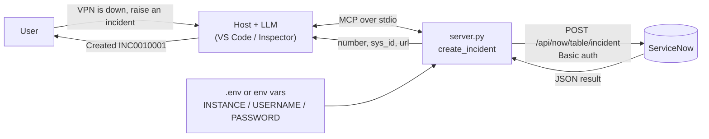
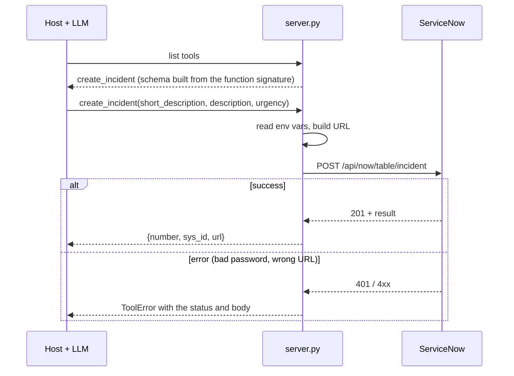

# e7 — Smallest ServiceNow MCP server

File: [server.py](server.py) (the whole thing, one file)

## What it is
- One file, one tool: `create_incident`
- Plain typed arguments, no Pydantic models, no config class
- Credentials come from a `.env` file next to `server.py` (loaded with `python-dotenv`) or from real environment variables. Real env vars win.
- stdio transport, so any Host (VS Code, Claude Desktop, Inspector) can launch it

## Flow





The tool's input schema comes straight from the function signature: argument names, types, and `Literal["1","2","3"]` for urgency and impact. The docstring and `description=` tell the LLM when to use it. No model class is involved, which is why this is the smallest version.

## Tool
| Argument | Required | Notes |
|---|---|---|
| `short_description` | yes | incident title |
| `description` | yes | details |
| `urgency` | no | `"1"` high, `"2"` medium (default), `"3"` low |
| `impact` | no | same scale |

Returns `number`, `sys_id`, and a `url` to open the incident.

## Setup
From `04_Day5_MCP/`:

```powershell
uv sync
copy e7_servicenow_minimal\.env.example e7_servicenow_minimal\.env
```

Edit `.env` and fill in your values (use the full host, no auto-expansion):

```
SERVICENOW_INSTANCE=dev12345.service-now.com
SERVICENOW_USERNAME=admin
SERVICENOW_PASSWORD=your-password
```

`.env` is git-ignored, `.env.example` is not. You can still skip the file and set the variables in your shell or in the Host's `env` block; those override `.env`.

A free ServiceNow Personal Developer Instance works fine for testing.

## Test it
1. **MCP Inspector** (easiest)
   ```powershell
   npx @modelcontextprotocol/inspector uv run python e7_servicenow_minimal/server.py
   ```
   Open Tools, then `create_incident`, fill the fields, Run. Check the incident exists in ServiceNow.

2. **VS Code** — add `.vscode/mcp.json`:
   ```json
   {
     "servers": {
       "servicenow-minimal": {
         "type": "stdio",
         "command": "uv",
         "args": ["run", "--directory", "${workspaceFolder}/42_course_Sep/04_Day5_MCP",
                  "python", "e7_servicenow_minimal/server.py"]
       }
     }
   }
   ```
   Then in Copilot chat (agent mode): "Raise an incident, VPN is down for the whole Pune office, high urgency."
   No secrets needed here: the server reads them from `.env`.

## Things that will bite you
- **Never `print()` in a stdio server.** stdout is the protocol. Use `print(..., file=sys.stderr)`.
- **Bare instance name isn't expanded.** `dev12345` fails; use `dev12345.service-now.com`.
- **Only `ToolError` text reaches the LLM (mcp 2.x).** A wrong password raises `ToolError("ServiceNow returned 401: ...")` so the model can tell the user. Any other exception (a `KeyError` for a missing env var, a network error) shows up only as `Error executing tool create_incident`; the details are in the server's stderr log.
- **`.env` is read once at startup.** Edit it, then restart the server in the Host.
- Needs `mcp>=2.3` (it imports `mcp.server.mcpserver`, not the old `fastmcp` module), `httpx` and `python-dotenv`.

## Next
[e8](../e8_servicenow_with_settings/README.md) adds a settings class, Pydantic input/output models, a read tool, and runs over streamable-http instead of stdio.
