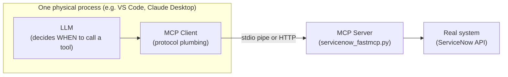
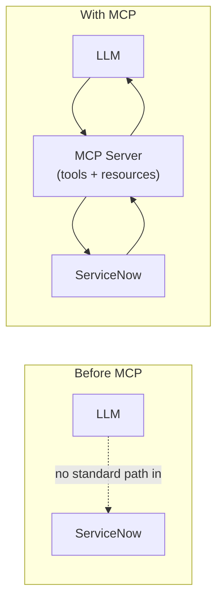
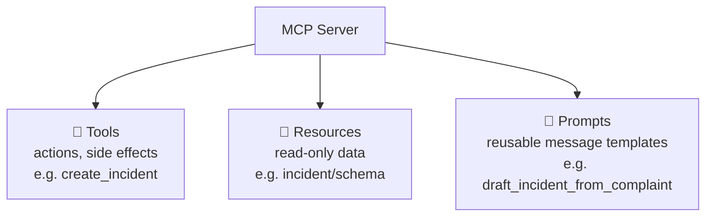
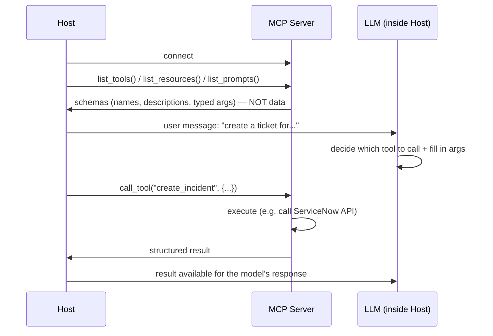

# Day 4 — MCP (Model Context Protocol)

**Target project this day builds toward**: [`26_service_now/`](../../26_service_now)
— a real FastMCP server exposing ServiceNow incident management as MCP
tools + a resource, mounted into FastAPI. Every example in this folder is
a smaller, stripped-down version of a pattern that project actually uses
in production. By the end of Day 4, `26_service_now/servicenow_fastmcp.py`
should read as "obviously the same shape as what we just built," not as
new material.

## Run it

```powershell
uv sync
uv run python examples/e1_minimal_mcp_server.py
```

---

## The Story: The Universal Power Adapter

Before smartphones standardized on USB, every device maker built its own
charger — its own plug shape, its own voltage quirks, its own cable. If
you had five gadgets, you carried five chargers. Every new device meant
negotiating a brand-new physical connection from scratch, and every
manufacturer had to design and support charging hardware for every wall
socket shape on Earth.

USB fixed this by defining one **standard plug shape and protocol**.
Once a device supports USB, it can charge from *any* USB power source —
a laptop, a wall adapter, a power bank — without either side needing to
know anything special about the other. The device doesn't care who's
supplying the power; the power source doesn't care what it's charging.

This is exactly the problem MCP (Model Context Protocol) solves for AI
agents. Before MCP, if you wanted an LLM to create a ServiceNow ticket,
you built a bespoke integration: custom prompt formats, custom function-
calling schemas, wired specifically into *one* Host (say, your own
chatbot). Want that same ServiceNow capability inside VS Code Copilot
too? Build it again, differently, because Copilot has its own integration
shape. Want it in Claude Desktop? Build it a third time.

MCP is the USB plug for tools. Once you expose ServiceNow as an MCP
server — with **tools** (things it can *do*), **resources** (things it
can *show*), and **prompts** (reusable question templates it can offer)
— *any* MCP-capable Host (VS Code, Claude Desktop, a custom agent
runtime) can plug into it, discover what it offers, and use it. You wrote
the server once. `26_service_now/servicenow_fastmcp.py` is a real,
working instance of exactly this: it doesn't know or care whether VS
Code Copilot or an Azure agent is the one calling `create_incident` —
that's the whole point.

## Why We Need MCP (the concrete version, not just the analogy)

- **Without MCP**: every (Host × Tool) pair needs its own integration
  code. 3 Hosts × 4 tools = potentially 12 bespoke integrations, each
  with its own way of describing what the tool does and what arguments
  it needs.
- **With MCP**: every tool is described *once*, in a standard shape
  (name, description, typed schema). Any MCP-capable Host can discover
  and call it. 3 Hosts × 4 tools = 4 tool implementations, full stop.
- **The model still does the thinking.** MCP doesn't make the LLM
  smarter at deciding *when* to create a ticket vs. search for one — it
  just guarantees that once the model decides, there's a reliable,
  discoverable, typed way to actually do it. Garbage tool descriptions
  still produce garbage tool-selection behavior (see Thought Question 1
  below) — MCP standardizes the *plumbing*, not the *judgment*.

---

## 1. Diagram Ideas (for the tutor to draw/present live)

**Diagram A — Host, Client, Server (the actual MCP architecture)**
Three boxes in a row: **Host** (e.g. VS Code / Claude Desktop / an
agent runtime — the thing a *human* interacts with) → **Client** (the
MCP client library embedded inside the Host, speaking MCP protocol) →
**Server** (your `FastMCP` process — e.g. `servicenow_fastmcp.py`).
Critically: draw the Host and Client as *one physical process* with an
internal boundary, and the Server as a *separate* process/service
reached over a transport (stdio pipe, or HTTP for
`servicenow_fastmcp.py`'s `streamable-http` transport). Most students
initially assume "client" means "the AI model" — correct that here: the
model lives in/behind the Host; the Client is just the protocol plumbing.



**Diagram B — Before/After: what an LLM can do without vs. with MCP**
Left side: a box labeled "LLM" with a dotted, broken arrow pointing at a
box labeled "Your ServiceNow instance" — labeled "No path in." Right
side: the same two boxes, but now connected through a middle box labeled
"MCP Server (tools + resources)" — solid arrows both directions. This is
the one-sentence pitch for why MCP exists: it's a standard *shape* for
"give a model a safe, discoverable path to do real things," so every
tool doesn't need its own bespoke integration per Host.



**Diagram C — Tools vs. Resources vs. Prompts (the 3 primitives)**
A 3-column table drawn as boxes, not text: **Tools** = "actions the model
can *invoke*, with side effects" (icon: a wrench) → point at
`create_incident` in `servicenow_fastmcp.py`. **Resources** = "data the
model (or Host) can *read*, no side effects" (icon: a book/file) → point
at `servicenow://incident/schema`. **Prompts** = "reusable, parameterized
message templates a Host can offer as a menu" (icon: a speech bubble) —
`26_service_now` doesn't use one yet; this is the gap Day 4's examples
fill in live.



**Diagram D — The discovery-then-invoke lifecycle**
A simple numbered sequence diagram: (1) Host connects to Server → (2)
Host calls `list_tools()`/`list_resources()`/`list_prompts()` → (3) Server
responds with **schemas**, not data → (4) an LLM (inside the Host) decides
which tool to call based on the user's message → (5) Host calls
`call_tool(name, args)` → (6) Server executes and returns a result. Point
directly at `discover_capabilities` in `servicenow_fastmcp.py` as a
*custom* tool that does extra "self-description" work — separate from
MCP's own built-in discovery mechanism (step 2) — and ask students to spot
the difference (this is a great segue into Thought Question 2 below).



---

## 2. Thought-Provoking Questions (ask before showing the answer)

1. "MCP servers describe their tools with a name, a description, and a
   typed schema — but the *model* is what decides when to call them.
   What could go wrong if a tool's `description` is vague or misleading,
   even if its underlying code is perfectly correct?" (Point at
   `create_incident`'s description in `servicenow_fastmcp.py` — it
   explicitly tells the model what to extract from the user's prompt
   before calling it.)
2. `servicenow_fastmcp.py` has both a built-in MCP discovery mechanism
   (any client can call `list_tools()`) *and* a custom tool called
   `discover_capabilities` that does something similar. "Why would a
   real project build a redundant-looking custom capability-description
   tool on top of a protocol that already has discovery built in? What's
   actually different about what each one returns?"
3. "A **Tool** has side effects; a **Resource** does not. `create_incident`
   is obviously a tool. Why is `servicenow://incident/schema` a
   *resource* and not a tool — what would break, conceptually, if it
   were implemented as a tool called `get_incident_schema` instead?"
4. "If your MCP server's `create_incident` tool has a bug that creates
   *duplicate* incidents on retry, is that an MCP problem, a ServiceNow
   API problem, or an agent-design problem? Who is responsible for
   fixing it, and at which layer?"
5. "The Host in the architecture diagram could be VS Code, Claude
   Desktop, or a custom agent runtime you write yourself. What does an
   MCP server gain by *not* caring which Host is calling it?"

---

## 3. Scenarios (build up to the target project)

Each file in [`examples/`](examples/) is runnable on its own and gets you
one step closer to understanding `26_service_now`. Do them in order.

### Scenario 1 — The smallest possible MCP server
[`examples/e1_minimal_mcp_server.py`](examples/e1_minimal_mcp_server.py)
— one `FastMCP` instance, one tool, run over stdio. **Predict first**:
what does running this file directly print or do? (Answer: almost
nothing visible — it starts a server waiting on stdio for a Host to
connect. This surprises people the first time; it's not a CLI script.)

### Scenario 2 — Tools with structured input/output (the ServiceNow pattern)
[`examples/e2_tool_with_pydantic_schema.py`](examples/e2_tool_with_pydantic_schema.py)
— a tool whose input is a Pydantic model (like `IncidentDraft`), so the
model gets a real typed schema to fill in, not just "a string." **Predict
first**: if you send the model an incomplete draft (missing a required
field), where does the rejection happen — inside your function, or
before it's even called?

### Scenario 3 — A resource vs. a tool that does the same lookup
[`examples/e3_resource_vs_tool.py`](examples/e3_resource_vs_tool.py) —
implements the *same* piece of data (a fake "incident schema") once as a
`@mcp.resource` and once as a `@mcp.tool`, side by side. **Predict
first**: functionally, could a Host get the same JSON out of both? What's
different about how each is *discovered and described* to the model?

### Scenario 4 — A prompt template (the missing piece from `26_service_now`)
[`examples/e4_prompt_template.py`](examples/e4_prompt_template.py) — a
`@mcp.prompt` that turns "user complains about X" into a structured
message asking the model to draft an `IncidentDraft`-shaped response.
**Predict first**: a prompt template doesn't call any API or touch any
data — so what is it actually for, if not "doing" something?

### Scenario 5 — Break it: the vague-description tool
[`examples/e5_break_the_description.py`](examples/e5_break_the_description.py)
— two versions of the *same* tool: one with a precise description (like
`create_incident`'s real one), one with a deliberately vague one
(`"Does incident stuff"`). **Predict first**, then if you have access to
an actual MCP-capable Host (Claude Desktop, Copilot Agent mode, etc.),
connect both and give the model an ambiguous natural-language request —
watch how much worse the vague version performs at picking the right
tool or filling in arguments correctly. This is the live version of
Thought Question 1.

### Scenario 6 — Mount it in FastAPI (closing the loop to `26_service_now`)
[`examples/e6_fastapi_mounted_mcp.py`](examples/e6_fastapi_mounted_mcp.py)
— takes Scenario 2's server and mounts it into a FastAPI app exactly the
way `26_service_now/fastapi_app.py` does (`mcp.streamable_http_app()` +
lifespan + `app.mount("/", mcp_asgi_app)`), plus one plain HTTP endpoint
alongside it. **Predict first**: once mounted, is `/mcp` a normal REST
endpoint you could `curl` and get JSON back from directly? Try it and see
why the answer matters.

---

## Where to go next

After Scenario 6, open `26_service_now/servicenow_fastmcp.py` and
`fastapi_app.py` side by side with `e2_tool_with_pydantic_schema.py` and
`e6_fastapi_mounted_mcp.py`. Have students annotate, line by line, which
lines in the real project map to which pattern they just built — this
"spot the pattern" exercise is more valuable than reading the real
project cold.
