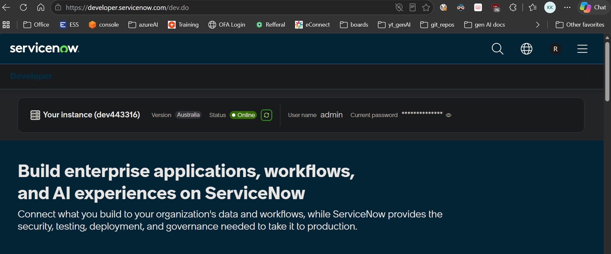
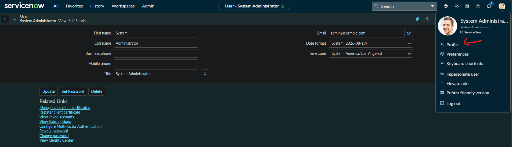
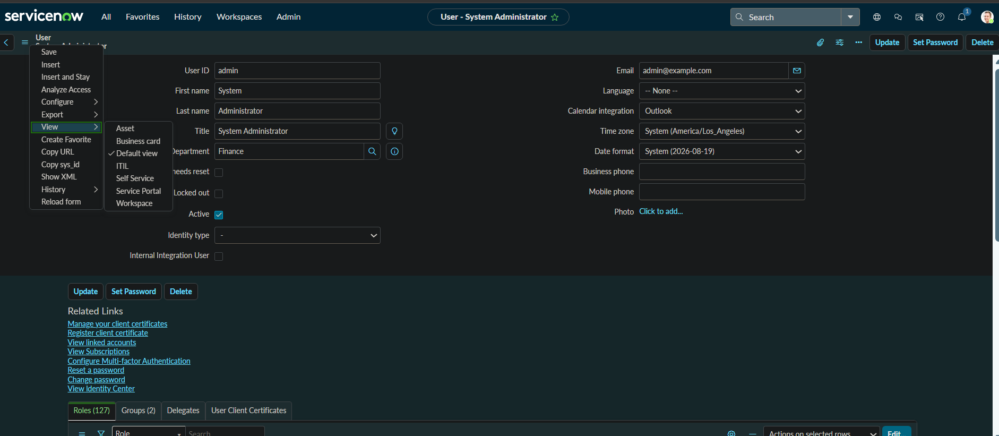
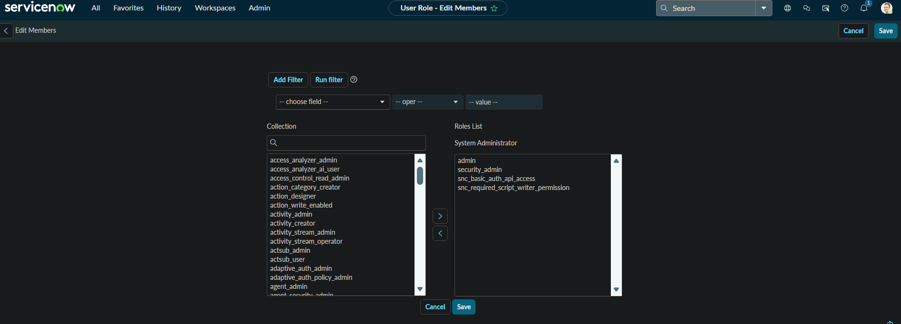

# Service Now Setup
##  Sign Up 
- Sign for a free Personal Developer Instance (PDI) at https://developer.servicenow.com (Request Instance)
<!-- -  -->
## Login to your dev instance, Grab the username and password
- 
  

sample url == https://YOURINSTANCEID_HERE.service-now.com/

## Click on your profile icon
- 
  

## On the left side near word `User` You have the 3 parallel line icon click that , then View > Defautl view
- 
  

## Now go down and see the Role section, on the right side click on `Edit`, Add the necessary roles as shown below in the image
- 
  
-