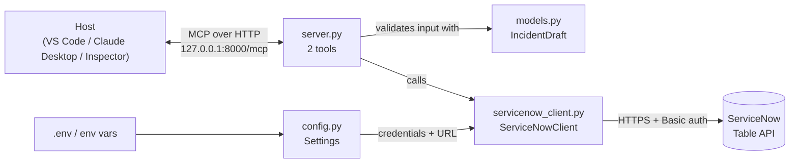
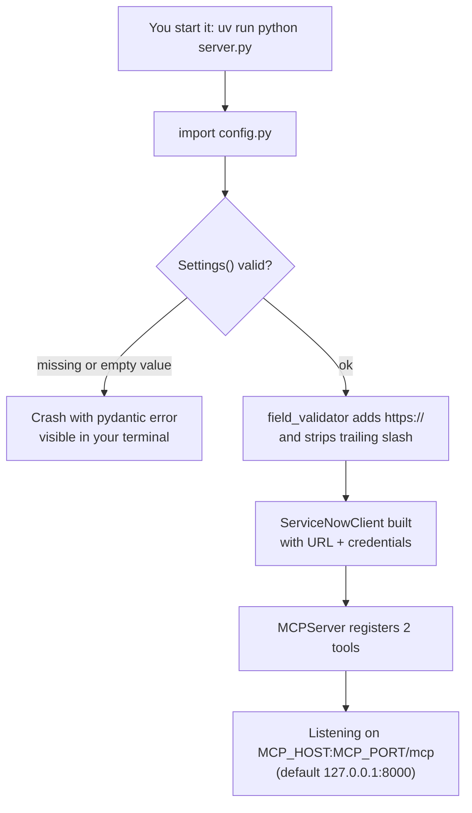
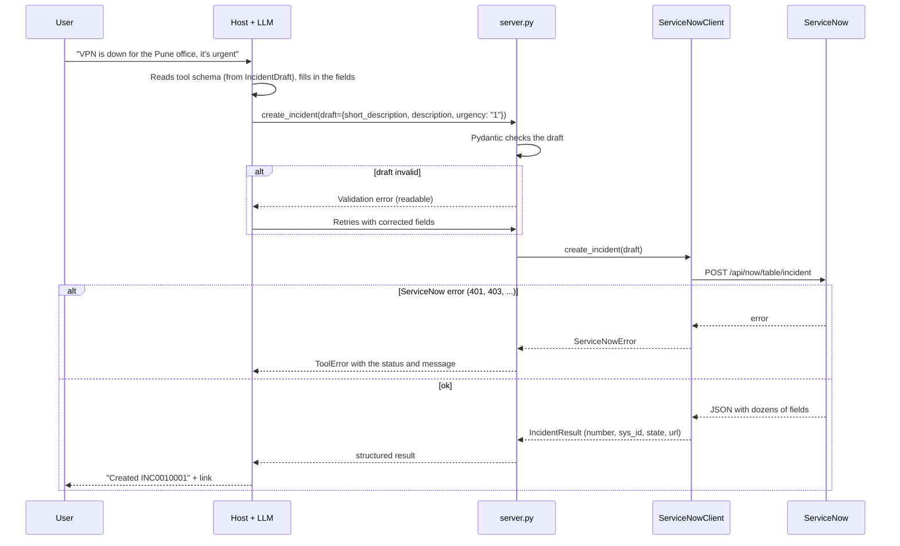
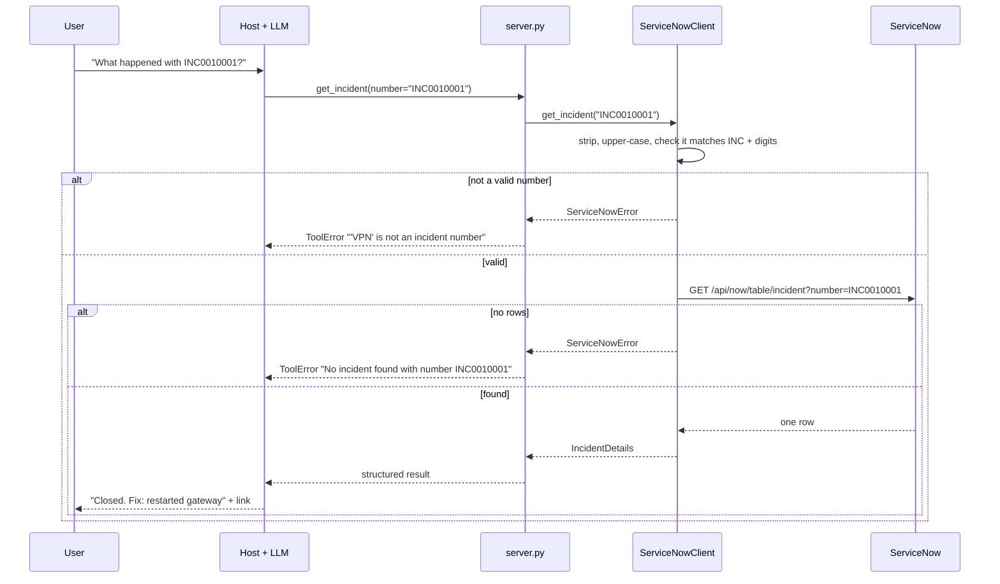

# e8 — ServiceNow MCP server with a settings class

Two features only: **create an incident** and **look up one incident by its number**.

**Transport: streamable-http.** Unlike [e7](../e7_servicenow_minimal/README.md) (stdio), this server is a long-running process you start yourself. Hosts connect to it by URL, `http://127.0.0.1:8000/mcp`. No FastAPI needed: `mcp.run(transport="streamable-http")` is enough.

Same idea as [e7](../e7_servicenow_minimal/README.md), with the structure the full `26_service_now_project` uses, in a few small files.

## Files
| File | Role |
|---|---|
| [config.py](config.py) | `Settings` class, loads `.env` / env vars |
| [models.py](models.py) | Pydantic input and output models |
| [servicenow_client.py](servicenow_client.py) | ServiceNow HTTP calls, no MCP code |
| [server.py](server.py) | The MCP server and the two tools |
| [.env.example](.env.example) | Template for your `.env` |

## Tools
| Tool | Input | Returns |
|---|---|---|
| `create_incident` | `draft`: `short_description`, `description`, optional `urgency`, `impact`, `category`, `caller_id` | `number`, `sys_id`, `state`, `url` |
| `get_incident` | `number`, e.g. `INC0010001` (case and spaces don't matter) | `number`, `short_description`, `description`, `state`, `urgency`, `opened_at`, `close_notes`, `url` |

How lookup works: the number is checked against the pattern `INC` + digits, then sent to ServiceNow as a plain field filter (`?number=INC0010001`). No query language, no search. A number that doesn't exist, or text that isn't a number, comes back as a readable error. Closed incidents include `close_notes`, so the LLM can reuse an earlier fix.

## How the pieces fit



### Startup



### `create_incident`



### `get_incident`



## Why we need these pieces

### Why models (`IncidentDraft`, `IncidentResult`, `IncidentDetails`)

A model does three jobs at once: it tells the LLM what to send, it checks what arrives, and it fixes the shape of what goes back.

| Model | Direction | Why it exists |
|---|---|---|
| `IncidentDraft` | LLM to server | Becomes the tool's input schema. The LLM sees field names, descriptions, and allowed values. Rules like `min_length=5` and `Literal["1","2","3"]` are checked before any ServiceNow call. |
| `IncidentResult` | server to LLM | ServiceNow returns dozens of fields per incident. The model keeps only `number`, `sys_id`, `state`, `url`. Smaller output, fewer tokens, predictable shape. |
| `IncidentDetails` | server to LLM | The lookup result, trimmed to the fields that help: number, title, description, state, urgency, date, close notes, link. |

Example 1, the model catches a bad value. The LLM sends `urgency: "high"`:
- With a loose `urgency: str` argument and no checks, `"high"` goes to ServiceNow, which may accept it and store garbage, or return a vague 400. (e7 avoids this for these two fields with `Literal`, but not for free-text rules like length.)
- With `IncidentDraft`, the server replies "urgency must be '1', '2' or '3'", the LLM retries with `"1"`. No ServiceNow call was wasted.

Example 2, the model guides the LLM. Field descriptions like `"1=high, 2=medium, 3=low"` end up in the tool schema. When the user says "this is urgent", the LLM knows to send `"1"`. Remove the descriptions and it has to guess.

Example 3, trimmed output. The raw ServiceNow response has fields like `sys_created_by`, `sla_due`, `opened_by` and many more. Returned as-is, all of that sits in the LLM's context for no benefit. `IncidentResult` returns four fields and `IncidentDetails` eight.

### Why `@field_validator("servicenow_instance")` and `@classmethod` in config.py

`@field_validator("servicenow_instance")` runs a function on that one field right after pydantic reads it from `.env`. It can clean the value or reject it.

| `.env` value | Result |
|---|---|
| `dev12345.service-now.com` | `https://dev12345.service-now.com` |
| `https://dev12345.service-now.com/` | `https://dev12345.service-now.com` (trailing slash removed) |
| `   ` (blank) | startup error: "SERVICENOW_INSTANCE cannot be empty" |

Why bother: the client builds URLs like `f"{instance}/api/now/table/incident"`.
- Without the `https://` fix, httpx fails with a "missing http:// or https://" error on the first tool call, long after startup.
- Without the slash fix, you get `https://x.com//api/now/...` with a double slash.
- Validating in one place means every user of `settings` gets a clean value, and mistakes surface at startup.

#### Why `@classmethod`, in simple terms

**Two kinds of methods in a Python class**
- A normal method works on **one object**. It gets `self`, which is "this particular `Settings`".
  ```python
  settings.some_method()      # self = the settings object you already have
  ```
- A class method works on **the class itself**, with no object needed. It gets `cls`, which is "the `Settings` blueprint".
  ```python
  Settings.some_method()      # cls = Settings, no object created yet
  ```

**Why the validator can't use `self`**
Think of building a house. `Settings` is the blueprint, and the `Settings` object is the finished house.
- Pydantic checks `servicenow_instance` *while it is building the house*, before it is finished.
- At that moment there is no house yet, so there is no `self` to hand to your function.
- All pydantic can pass is the blueprint, which is `cls`. So the function is marked `@classmethod`.

**What it looks like**
```python
@field_validator("servicenow_instance")   # 1. "run this on that field"
@classmethod                              # 2. "and it belongs to the class, not an object"
def normalize_instance(cls, value: str) -> str:
    ...
    return instance                       # 3. give back the (cleaned) value
```
- `value` is the raw text from `.env`, for example `dev12345.service-now.com`.
- You return the cleaned text, and pydantic stores that in the field.
- You almost never use `cls` inside. It's just the slot that has to be there.

**What happens if you leave it out** (checked with pydantic 2.x)
| You write | Result |
|---|---|
| `@classmethod` + `cls` | Works. This is the normal, recommended form. |
| no `@classmethod`, first parameter named `cls` | Still works, because pydantic notices the name `cls` and adds it for you. Don't rely on it: editors and type checkers get confused. |
| no `@classmethod`, first parameter named `self` | Fails as soon as the file loads: "`@field_validator` cannot be applied to instance methods". |

**Rules to remember**
- Order: `@field_validator(...)` on top, `@classmethod` directly below it.
- Always write `cls` as the first parameter, then the value.
- Return the value, or `raise ValueError("message")` to reject it.
- This is pydantic v2 syntax. The old v1 name was `@validator`.

### Why a `Settings` class instead of `os.environ[...]` (e7)

| e7: `os.environ["X"]` | e8: `Settings` |
|---|---|
| Missing variable gives `KeyError` on the first tool call | Fails at startup with a clear message |
| Values used as typed | Validated and cleaned once, reused everywhere |
| Password is a plain string, easy to log by accident | `SecretStr` prints as `**********` |

### Why `ToolError` in `server.py` (mcp 2.x)

In mcp 2.x only a `ToolError` message is passed to the LLM. Any other exception (a `RuntimeError`, an `httpx` error) reaches the model as just `Error executing tool create_incident`, and the details stay in the server log.

So the split is:
- `servicenow_client.py` raises `ServiceNowError` for failures we expect: bad credentials, host unreachable, malformed or unknown incident number.
- `server.py` turns it into `ToolError(str(exc))`.
- Result: the LLM can tell the user "ServiceNow returned 401: User Not Authenticated" instead of a vague failure.

## Setup
From `04_Day5_MCP/`:

```powershell
uv sync
```

Copy `.env.example` to `.env` in this folder (`e8_servicenow_with_settings/`) and fill it in. `config.py` looks for `.env` next to itself, so it works from any launch directory:

```
SERVICENOW_INSTANCE=dev12345.service-now.com
SERVICENOW_USERNAME=admin
SERVICENOW_PASSWORD=your-password
# SERVICENOW_TIMEOUT_SECONDS=30
# MCP_HOST=127.0.0.1
# MCP_PORT=8000
```

Then start the server and leave it running:

```powershell
uv run python e8_servicenow_with_settings/server.py
```

It prints `Uvicorn running on http://127.0.0.1:8000`. Stop it with Ctrl+C. After editing `.env`, stop and start it again.

`MCP_HOST` and `MCP_PORT` are optional. `.env` is git-ignored. Or skip the file and set env vars as in e7; real env vars win. For real use, make a dedicated ServiceNow account that can only create and read incidents.

## Test it
1. **MCP Inspector**
   With the server running, in a second terminal:
   ```powershell
   npx @modelcontextprotocol/inspector
   ```
   In the Inspector choose transport **Streamable HTTP**, URL `http://127.0.0.1:8000/mcp`, then Connect.
   Try in this order: `create_incident`, then `get_incident` with the number it returned.

   **Example 1: `create_incident`** (in the Inspector, paste this into the `draft` field)
   ```json
   {
     "short_description": "VPN not connecting from Pune office",
     "description": "Since 9am nobody in the Pune office can connect to the VPN. Error: gateway timeout. Restarting the client did not help.",
     "urgency": "1",
     "impact": "2",
     "category": "network"
   }
   ```
   Expected result (your number and link will differ):
   ```json
   {
     "number": "INC0010042",
     "sys_id": "9f1c...",
     "state": "1",
     "url": "https://dev12345.service-now.com/nav_to.do?uri=incident.do?sys_id=9f1c..."
   }
   ```
   Then open the `url` and check the incident exists with urgency 1 (High). Only `short_description` and `description` are required.

   **Example 2: `get_incident`** (use the `number` returned above)
   ```json
   { "number": "INC0010042" }
   ```
   Expected result (a new incident has no close notes yet):
   ```json
   {
     "number": "INC0010042",
     "short_description": "VPN not connecting from Pune office",
     "description": "Since 9am nobody in the Pune office can connect ...",
     "state": "New",
     "urgency": "1 - High",
     "opened_at": "2026-11-14 10:32:11",
     "close_notes": null,
     "url": "https://dev12345.service-now.com/nav_to.do?uri=incident.do?sys_id=9f1c..."
   }
   ```
   Typing `inc0010042` (lower case, extra space) works too. To see `close_notes`, look up an incident that is already closed.

   **Example 3: prompts for a chat Host** (VS Code Copilot agent mode)
   - "Raise an incident: VPN is down for the whole Pune office since 9am, gateway timeout, high urgency." The LLM turns this into the `draft` above.
   - "What is the status of INC0010042?" The LLM calls `get_incident`.
   - "Create an incident for the VPN problem, then show me its details." It chains both tools.

2. **VS Code** `.vscode/mcp.json`. The server must already be running. VS Code connects to it, it does not launch it:
   ```json
   {
     "servers": {
       "servicenow": {
         "type": "http",
         "url": "http://127.0.0.1:8000/mcp"
       }
     }
   }
   ```
   There are no secrets in this file. They stay in the server's `.env`.

   **Quick check without any Host** (the server answers plain HTTP POSTs):
   ```powershell
   curl.exe -s http://127.0.0.1:8000/mcp -H "Content-Type: application/json" -H "Accept: application/json, text/event-stream" -d "{\"jsonrpc\":\"2.0\",\"id\":1,\"method\":\"initialize\",\"params\":{\"protocolVersion\":\"2025-06-18\",\"capabilities\":{},\"clientInfo\":{\"name\":\"curl\",\"version\":\"0\"}}}"
   ```
   A reply containing `"serverInfo"` or the server `instructions` means it's up. A `400 Missing session ID` is also a sign it's up: the server tracks sessions, so a bare `tools/list` without `initialize` first is rejected. "Connection refused" means it isn't running.

3. **Try breaking it**
   - `create_incident` with `short_description: "x"` returns a validation error before any ServiceNow call.
   - `get_incident` with `number: "VPN"` returns "'VPN' is not an incident number", and `INC9999999` returns "No incident found". Neither shows a stack trace.
   - Put a wrong password in `.env`. Both tools return "ServiceNow returned 401", which the LLM can read.
   - Remove `SERVICENOW_PASSWORD` and the server won't start at all.
   - `get_incident` with `INC1^active=false` is rejected by the number check, so user text never becomes part of a ServiceNow query.

## Things that will bite you
- **Settings load at import time.** A missing value stops the server right at startup, with the pydantic error in your terminal.
- **There is no login on `/mcp`.** The server holds your ServiceNow credentials, so anyone who can reach the port can create incidents as that account. That's why `MCP_HOST` defaults to `127.0.0.1`. Don't set it to `0.0.0.0` or deploy it until you add authentication.
- **Localhost only is also enforced for requests:** a request with a different `Host` header (DNS-rebinding trick) is refused with HTTP 421.
- **Start it before the Host.** If the server isn't running, the Host just shows a connection error.
- **Port already in use.** Change `MCP_PORT` in `.env` and in the Host URL.
- **`.env` lives next to `config.py`**, not in the working directory. Real environment variables still override it.
- `print()` is safe here, unlike with stdio, because stdout is not the MCP channel.
- **Lookup is exact.** There is no search by words. Add that later with a `short_descriptionLIKE...` query (see 26_service_now_project).
- httpx logs each ServiceNow request line to the terminal. That's harmless.

## From here to the full project
`26_service_now_project` uses the same split (`config.py`, `models.py`, `servicenow_client.py`, plus the server file), adds a config tool and a solutions search, and mounts the server in FastAPI over streamable-http (see [e6](../01_examples/e6_fastapi_mounted_mcp.py)).

### How to run it


1. Start the server yourself in one terminal and leave it running:
   ```
   uv run python e8_servicenow_with_settings/server.py
   ```
  
2. In a second terminal, start the Inspector with no flags:
   ```
   npx @modelcontextprotocol/inspector
   ```
3. Choose **Streamable HTTP** as the transport.
4. Use the URL **`http://127.0.0.1:8003/mcp`**, not 8000. Your log shows port 8003, so `MCP_PORT` in your `.env` is probably 8003, and the docstring is out of date.

**Will it work with Claude?**

It depends on which Claude you use:

- **claude.ai (web/mobile):** No, not with `127.0.0.1`. Custom connectors need a publicly reachable HTTPS URL, so you'd have to tunnel (ngrok or cloudflared) or deploy it. Because the endpoint has no authentication, add auth first, since anyone with the URL could create incidents with your ServiceNow credentials.
- **Claude Desktop:** The simplest route is to run the server over stdio. Switch the transport:
  ```python
  mcp.run(transport="stdio")
  ```
  Then add it to `claude_desktop_config.json` with `command: "uv"` and `args: ["run", "python", "<full path>/server.py"]`. In stdio mode, don't `print()` to stdout, because it corrupts the protocol. Log to stderr instead.
- **STDIO in the Inspector too:** The same stdio change would make your original `uv run python server.py` Inspector entry work as-is.

One more thing to check: run `uv run python server.py` from the folder that contains `config.py`, `models.py` and `.env`. The Inspector's launch command may use a different working directory than the one in your docstring.

Do you want a small tweak so the transport is switchable via an env var (`MCP_TRANSPORT=stdio|streamable-http`)? That way the same file works for both the Inspector and Claude Desktop.

## How to add in claude
Claude Desktop's config file only launches **stdio** servers (`command` + `args`). It can't take a plain HTTP URL. The workaround is **`mcp-remote`**, a small bridge that Claude launches over stdio and that forwards to your running HTTP server.

**Steps**

1. **Start your server** in a terminal and leave it running:
   ```
   uv run python e8_servicenow_with_settings/server.py
   ```
   Confirm it shows `http://127.0.0.1:8003`. Use whatever port is in your log.

2. **Make sure Node.js is installed** (`node -v`), since `npx` is needed.

3. **Open the config file:** in Claude Desktop go to Settings → Developer → Edit Config. On Windows the file is `%APPDATA%\Claude\claude_desktop_config.json`.

4. **Add your server:**
   ```json
   {
     "mcpServers": {
       "servicenow": {
         "command": "npx",
         "args": [
           "-y",
           "mcp-remote",
           "http://127.0.0.1:8003/mcp",
           "--allow-http",
           "--transport",
           "http-only"
         ]
       }
     }
   }
   ```
   If the file already has other entries in `mcpServers`, add yours alongside them rather than replacing them.

5. **Fully quit and restart Claude Desktop.** Closing the window isn't enough, so quit from the system tray on Windows.

6. **Verify:** open a new chat, click the tools/connectors icon, and look for `servicenow` with `create_incident` and `get_incident`. Then try: "Get details of INC0010004."

**Troubleshooting**

- **Windows `npx` not found:** use `"command": "cmd"` and `"args": ["/c", "npx", "-y", "mcp-remote", "http://127.0.0.1:8003/mcp", "--allow-http", "--transport", "http-only"]`.
- **Server shows as failed:** check `%APPDATA%\Claude\logs\mcp-server-servicenow.log`. It will show connection refused if your server isn't running or the port is wrong.
- **JSON errors:** a trailing comma or a single backslash in the file will stop the config from loading.
- **Order matters:** your HTTP server must already be running when Claude Desktop starts. If you start it later, restart Claude Desktop.

**Other options**

- **Claude Code:** it supports HTTP directly, with no bridge needed:
  ```
  claude mcp add --transport http servicenow http://127.0.0.1:8003/mcp
  ```
- **claude.ai web or mobile:** these can't reach `127.0.0.1`. You'd need a public HTTPS URL (ngrok, cloudflared, or a deployment), added under Settings → Connectors.

Your endpoint has no authentication, so keep it bound to `127.0.0.1`, and add auth before ever exposing it through a tunnel.

### References
- https://www.servicenow.com/docs/r/api-reference/rest-apis/c_TableAPI.html
- https://www.servicenow.com/docs/r/api-reference/rest-api-explorer/t_GetStartedCreateInt.html
- https://www.servicenow.com/docs/r/platform-user-interface/r_NavigatingByURLExamples.html