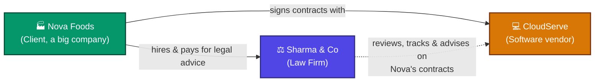
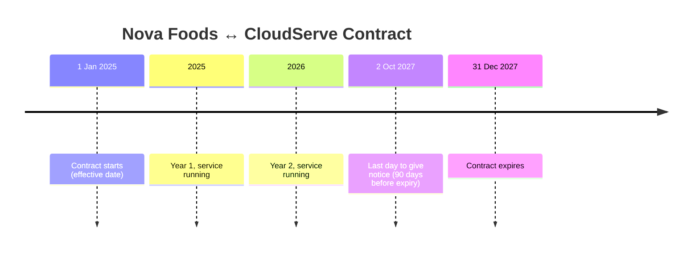
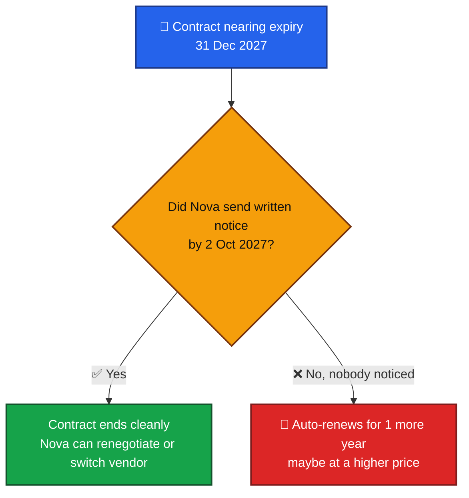
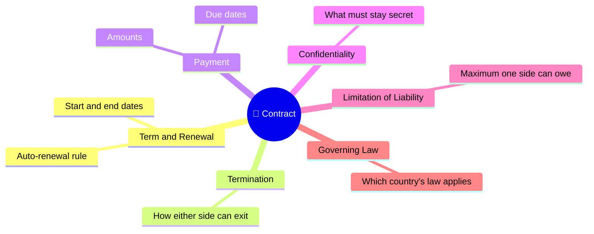
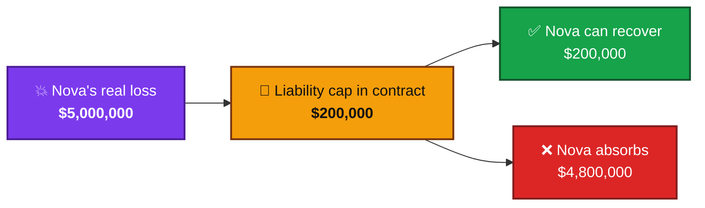
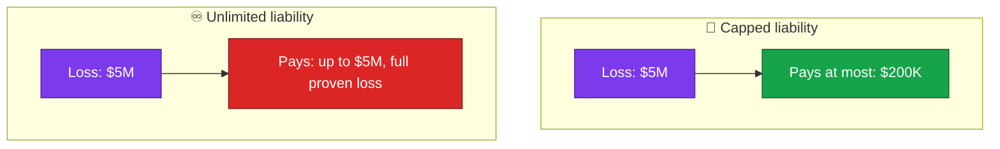
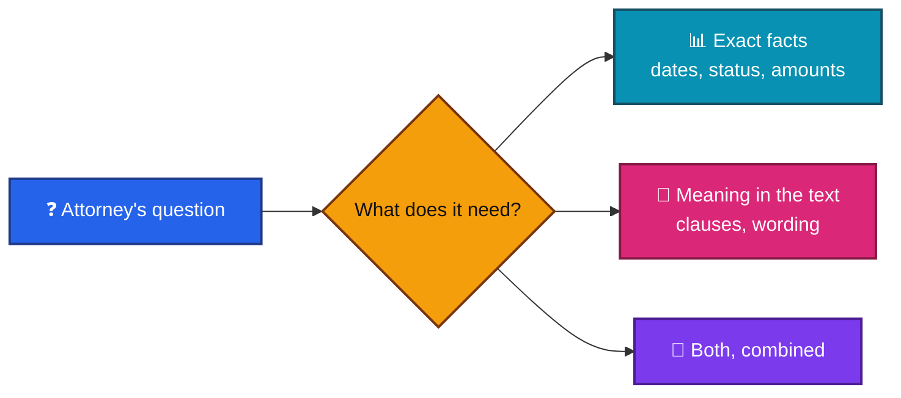

# Untitled

# The Law Firm Contract Problem: A Story

> **Purpose:** understand the business problem first. No solution is given here, so you can think about how you would build one.
*This is a simplified explanation for learning, not legal advice.*
> 

---

## 1. Who is who?

**Important:** the contracts in this story are **not** between the law firm and its client.
They are contracts the **client has with other companies** (vendors, customers, landlords). The law firm reviews and tracks them. The firm itself is paid separately, usually hourly or on a retainer.

---

## 2. What is a contract, and what does "expiry" mean?

Nova Foods signs a **3-year contract** with CloudServe for its inventory software.

- **Effective date:** when the contract starts (1 Jan 2025).
- **Expiry date:** when it ends (31 Dec 2027). After this date CloudServe has no duty to provide the service and Nova has no duty to pay, unless the contract is renewed.

> **Common confusion:** "90 days" is **not** how long the law firm works for the client. It is a **notice period** or a **search window**, explained below.
> 

---

## 3. The auto-renewal trap

Hidden in the contract is this clause:

> *"This agreement renews automatically for 1 year unless either party gives written notice at least 90 days before expiry."*
> 

| Term | Meaning in this story |
| --- | --- |
| **Auto-renewal** | Contract extends itself unless someone acts |
| **Notice period** | How early you must tell the other side you are leaving (90 days here) |
| **Notice deadline** | Expiry date minus notice period = **2 Oct 2027** |

**The real pain:** companies have hundreds of contracts, each with its own dates. Missing one deadline can lock them in for another year.

---

## 4. What is a clause?

A contract is a long document split into numbered sections. Each section is a **clause**.

Lawyers rarely read a whole contract. They hunt for specific clauses, and **the wording of a clause can be very different from contract to contract.**

---

## 5. Liability: who pays when things go wrong?

**Liability** means who pays, and how much, when something goes wrong.

CloudServe's contract says:

> *"CloudServe's total liability is limited to the fees Nova paid in the preceding 12 months."*
> 

Nova pays CloudServe **$200,000 per year**.

### The incident

CloudServe's software has a bug. Nova's warehouses stop for 3 days. Nova loses **$5,000,000** in spoiled stock and missed orders.

The cap is **25 times smaller** than the damage. This is why a lawyer reads the *Limitation of Liability* clause very carefully.

---

## 6. Unlimited liability

Suppose Sharma & Co negotiates, and the clause becomes:

> *"CloudServe is liable for all losses arising from its breach."*
> 

That is **unlimited liability**: there is **no ceiling** on what the breaching side can owe.

It looks different depending on which side your client is on:

| Your client is the… | Unlimited liability means… |
| --- | --- |
| **Buyer** (e.g. Nova) | Strong protection, which is good |
| **Seller** (e.g. a software company) | A dangerous risk. One bug could bankrupt them, so the lawyer must flag it |

> Real contracts often add carve-outs, for example a cap that does not apply to data breaches or fraud. This is another reason a human has to read the exact wording.
> 

---

## 7. Putting it together: the problem to solve

Nova Foods has **hundreds of contracts** across many vendors, customers and landlords. The attorney at Sharma & Co gets questions like these:

| # | Question | What kind of information is needed? |
| --- | --- | --- |
| 1 | "Which contracts expire in the next 90 days?" | Exact dates |
| 2 | "What does the liability clause say in the CloudServe contract?" | Meaning inside the text |
| 3 | "Which contracts auto-renew within 90 days **and** have unlimited liability?" | Both of the above |
| 4 | "Draft a warning email to Nova about contracts at risk" | Findings plus an action |

### Real-world constraints

- **Confidentiality:** Nova's contracts must **never** be visible to another client of the firm.
- **Trust:** a lawyer cannot rely on an answer without seeing **where in which document** it came from.
- **Volume:** reading hundreds of contracts by hand does not scale.
- **Cost of a miss:** a missed deadline or an overlooked risky clause can cost real money.

---

## 8. Business value of solving this

| Problem today | Value if solved |
| --- | --- |
| Missed renewal deadlines | Early warnings, with time to renegotiate |
| Slow manual review | Hours become minutes |
| Hidden risky clauses | Risk visible across the whole portfolio |
| Unverifiable answers | Every answer points back to the source |
| Data mix-ups between clients | Each client sees only its own contracts |

---

## 9. Think about it (no answers given)

1. Which of the four questions in section 7 could a **normal database query** answer? Which could not?
2. Why might a simple keyword search for "unlimited liability" **miss** a contract that has this risk?
3. Every contract might word the same idea differently. How could software recognise that two different sentences mean the same thing?
4. Where would you store the **dates and amounts**, and where would the **full contract text** live? Are they the same place?
5. How would you guarantee that Nova's staff can **never** see another client's contracts, even if the software makes a mistake?
6. When is a **single question-and-answer bot** enough, and when would you need something that plans several steps and takes actions?
7. Which actions (sending an email, changing a record) should require a **human to approve** first, and why?
8. How would you **test** that the system's answers are correct before a law firm trusts it?

---

## 10. Glossary

| Term | Meaning |
| --- | --- |
| **Effective date** | The date a contract starts |
| **Expiry date** | The date a contract ends |
| **Auto-renewal** | The contract extends itself unless someone gives notice |
| **Notice period** | How early you must tell the other side you are leaving |
| **Clause** | One numbered section of a contract |
| **Liability** | Who pays, and how much, when something goes wrong |
| **Limitation of liability** | A cap on how much one side can owe |
| **Unlimited liability** | No cap; the breaching side owes all proven losses |
| **Counterparty** | The other company in a contract |
| **Carve-out** | An exception to a rule in a clause (e.g. the cap does not apply to fraud) |