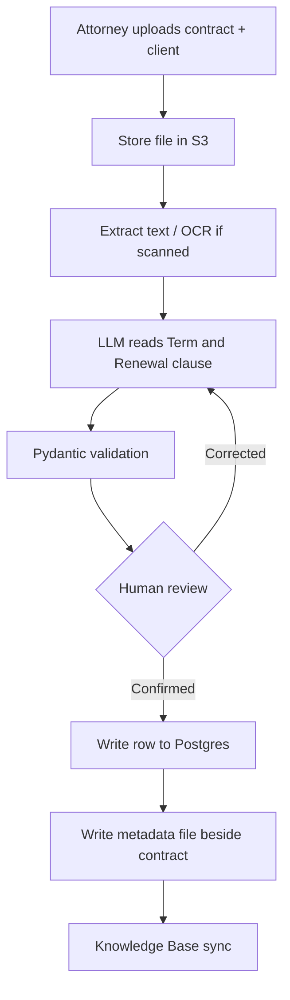

## Langraph project law firm
1) Create a .env from .env.example file
2) Install aws cli and configure aws keys with suitable bedrocka dn s3 permission. Create an s3 bucket example `langraph-lawfirm-contracts-1234567890-us-east-1-an`
3) uv sync, activate the environement in the terminal
4) Don't upload the files by handing in the console (Terminal or UI) use `uv run python scripts/upload_to_kb.py`, this also creates, .metadata.json files

```bash
uv run python scripts/upload_to_kb.py
uploaded s3://langraph-lawfirm-contracts-1234567890-us-east-1-an/contracts/NOV-001_cloudserve_saas.md  (+ metadata)
uploaded s3://langraph-lawfirm-contracts-1234567890-us-east-1-an/contracts/NOV-002_prime_logistics_lease.md  (+ metadata)
uploaded s3://langraph-lawfirm-contracts-1234567890-us-east-1-an/contracts/NOV-003_brightmart_supply.md  (+ metadata)
uploaded s3://langraph-lawfirm-contracts-1234567890-us-east-1-an/contracts/NOV-004_quickship_couriers.md  (+ metadata)
uploaded s3://langraph-lawfirm-contracts-1234567890-us-east-1-an/contracts/NOV-005_orbit_payments.md  (+ metadata)
uploaded s3://langraph-lawfirm-contracts-1234567890-us-east-1-an/contracts/NOV-006_greenline_packaging.md  (+ metadata)
uploaded s3://langraph-lawfirm-contracts-1234567890-us-east-1-an/contracts/GRN-001_cloudserve_saas.md  (+ metadata)
uploaded s3://langraph-lawfirm-contracts-1234567890-us-east-1-an/contracts/GRN-002_metro_realty_lease.md  (+ metadata)bash

```
5) You may verify the upload docs via aws s3 ls s3://YOUR_BUCKET_NAME/contracts
6) create a knowledge base from UI
### Quick steps:
- Go to Amazon Bedrock > Knowledge Bases(KB)
- Click Create Managed KB (the orange button in the UI).
- Name it, e.g. lawfirm-contracts-kb.
- Under Data source, choose Amazon S3.
- Enter the bucket langraph-lawfirm-contracts-1234567890-us-east-1-an.
- Keep the defaults (managed embedding, "Create and use a new service role").
- Click Create Knowledge Base, then wait 2-5 minutes.
- Open the data source and click Sync.

7) `uv run streamlit run v1_rag_only/app.py`

## incase you plan to delete the kb

aws bedrock-agent delete-data-source --region us-east-1 --knowledge-base-id <KB_ID> --data-source-id <DS_ID>
aws bedrock-agent delete-knowledge-base --region us-east-1 --knowledge-base-id <KB_ID>


## V2_rag
- docker compose -f v2_rag_plus_postgres/docker-compose.yml up -d
- uv run python v2_rag_plus_postgres/seed.py

## Refernces are in
- v2_rag_plus_postgres\README.md
- questions are in v1_rag_only\sample_questions.md

## How sample_data.py was made, Contract Metadata: How the Structured Table Gets Built

The contract text is the source of truth, and the metadata table has to be built from it. There are three usual options.

## How It Works

| Approach | How it works | Trade-off |
|---|---|---|
| **People enter it** | A paralegal reads each contract and fills a form | Accurate if careful, but slow and costly at hundreds of contracts |
| **LLM extracts it** | At upload time, a model reads the contract and returns the dates, notice period, auto-renew flag, etc. | Fast and cheap, but it can be wrong, so it needs checking |
| **Existing system** | The firm or client already has a contract management system, and you sync from it | Cleanest if one exists |

**In real life:** most systems use the LLM option with a person reviewing the result.

## A Realistic Upload Pipeline

1. **Upload:** An attorney uploads a contract. The upload form says which client it belongs to.
2. **Store and extract text:** The file goes to S3, and the text is extracted (OCR first if it's a scanned PDF).
3. **LLM extraction and validation:** An LLM reads the "Term and Renewal" clause and returns structured fields. A Pydantic model (as in your Day 4 lessons) validates them:
   - dates parse correctly
   - `notice_days` is a positive number
   - expiry is after the start date
4. **Human review:** A person confirms the result, especially when the model is unsure. A wrong date means a missed deadline, so store the **quoted clause** next to the value.
5. **Persist and sync:** The row is written to Postgres, the metadata file is written beside the contract, and the Knowledge Base syncs.

## Pipeline Diagram

