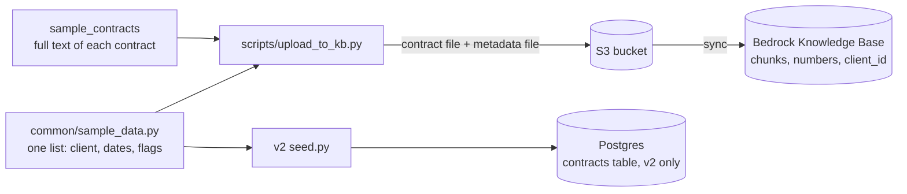
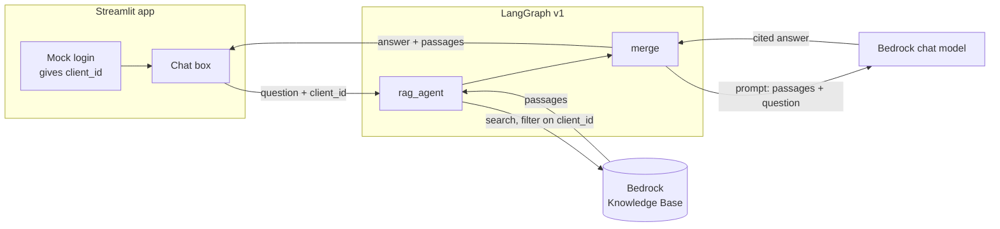
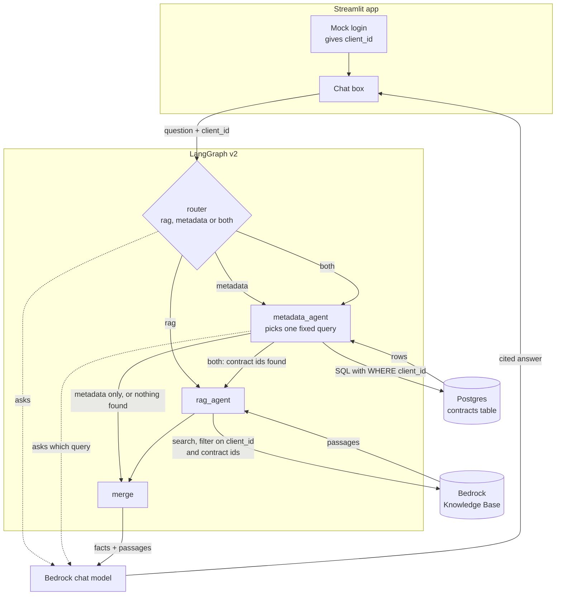
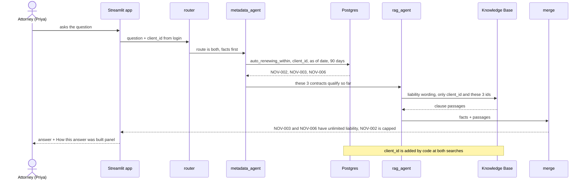

# Law Firm Contract Assistant

A small project built in two versions. Read [lf_contract_problem.md](lf_contract_problem.md) first: it tells the story of Sharma & Co, their client Nova Foods, and the four questions an attorney keeps asking. This project is one way to answer them.

All contracts and companies here are made up, for teaching. This is not legal advice.

## Think in order

This is the order an engineer would work through the problem, and the order the code is built.

1. **What does each question need?** The problem doc's section 7 already sorts them:

   | Question | Needs |
   |---|---|
   | 1. Which contracts expire in the next 90 days? | exact dates |
   | 2. What does the liability clause say in the CloudServe contract? | meaning inside the text |
   | 3. Which contracts auto-renew within 90 days **and** have unlimited liability? | both |
   | 4. Draft a warning email | findings plus an action (not built here, see the end) |

2. **Question 2 first: search the text.** A keyword search misses "shall be liable for all losses" when you look for "unlimited liability". So we search by meaning, using a **Bedrock Knowledge Base** (it splits the contracts into chunks, turns each into numbers, and finds the closest ones to the question). An LLM then writes the answer from those chunks only, and cites them. That is **v1**.

3. **Try question 1 on v1, and watch it fail.** The model only sees a few text chunks. It has no table of dates and no idea what "today" is. Dates and flags are exact facts, so they belong in a database: **Postgres**, one row per contract. Full text stays in the Knowledge Base. Same contracts, two places, each used for what it is good at.

4. **Question 3 needs both, in order.** Postgres first answers "which contracts auto-renew within 90 days?" Then the Knowledge Base reads the liability clause of **only those contracts**. The second step depends on the first, so they run one after the other, not at the same time.

5. **Someone must pick the path.** A small **router** reads the question and chooses: `rag`, `metadata` or `both`.

6. **Keep clients apart.** The login decides which client you are. Our code adds that `client_id` to every Knowledge Base search and every SQL query. The LLM never sees it and cannot change it. Even if the model is confused, it cannot ask for another client's contracts.

7. **Make answers checkable.** Every answer cites the contract it came from, and the app has a panel showing which agent did what.

## The two versions

| | v1 | v2 |
|---|---|---|
| Folder | [v1_rag_only](v1_rag_only/README.md) | [v2_rag_plus_postgres](v2_rag_plus_postgres/README.md) |
| Agents | RAG agent, merge | router, metadata agent (Postgres), RAG agent, merge |
| Question 1 (dates) | fails on purpose | works |
| Question 2 (clause) | works | works |
| Question 3 (both) | partial at best | works |

### Where the data comes from

Set up once, before either version runs. Both stores are filled from the same list of contracts, so they cannot disagree.



### v1: how it fits together

One agent searches, one step writes the answer.



What v1 can and cannot do: it sees only the few passages the search returns. Fine for "what does the clause say". Not enough for "which contracts expire soon".

### v2: how it fits together

A router chooses the path. Postgres is added for exact facts.



Solid arrows are data. Dotted arrows are small LLM calls that only make a choice. The `client_id` is added by code at the Postgres and Knowledge Base arrows. The LLM never sees it.

### v2: one question, step by step

Question 3, "Which contracts auto-renew within 90 days and have unlimited liability?", needs both agents, one after the other.



If Postgres finds nothing, the graph skips the Knowledge Base and says no contracts match.

## Setup

You need: `uv`, an AWS account with Bedrock access, and (for v2) Docker.

1. Copy `.env.example` to `.env`, fill in `AWS_REGION`, `S3_BUCKET` and `BEDROCK_MODEL_ID`. AWS credentials come from your normal AWS setup.
2. `uv sync`
3. Upload the contracts. This also uploads a small metadata file next to each one (client, contract id, company), which is what makes the client filter possible. Do this **before** creating or syncing the Knowledge Base.
   ```bash
   uv run python scripts/upload_to_kb.py
   ```
4. In the AWS console, create a Bedrock **Knowledge Base** with an S3 data source pointing at that bucket and prefix, an embeddings model, and the quick-create vector store. The console wizard changes over time, so follow its current steps. Put the Knowledge Base id and data source id in `.env` (`KB_ID`, `KB_DATA_SOURCE_ID`), then start a sync:
   ```bash
   uv run python scripts/upload_to_kb.py --sync
   ```
   Wait until the sync shows **Complete** in the console.
5. Your AWS user or role needs permission for `bedrock:Retrieve`, `bedrock:InvokeModel` (for your chosen model), and S3 and `bedrock:StartIngestionJob` for the upload script.

Steps 1 to 5 are shared. After that, pick a version.

### Note: `uv init` and the `src` folder

This project is **flat**: no `src` folder, and `pyproject.toml` has no `[build-system]`. `uv sync` only installs the dependencies, so it just works.

If you start your own project with `uv init`, a recent uv (we checked 0.12.3) creates a **packaged** project: a `src/<name>/__init__.py` folder and a `[build-system]` section. `uv sync` then builds your project too, so **deleting `src` makes it fail**:

```
× Failed to build `my-project`
╰─▶ Expected a Python module at: src\my_project\__init__.py
```

To get a flat project instead:

- New project: `uv init --no-package my-project` (gives a `main.py`, no `src`).
- Existing project: delete the `[build-system]` and `[project.scripts]` sections from `pyproject.toml` (both, together), then delete `src`.

Older uv versions created the flat layout by default, so you may see both styles in tutorials.

## Run

Always run from the project root (the folder with this README).

**v1 (RAG only).** Needs no Docker and no Postgres.

```bash
uv run streamlit run v1_rag_only/app.py
```

**v2 (RAG + Postgres).** Needs Docker for Postgres, on top of the shared setup.

```bash
# 1. start Postgres (host port 5433)
docker compose -f v2_rag_plus_postgres/docker-compose.yml up -d

# 2. create the table and load the sample contracts (safe to run again)
uv run python v2_rag_plus_postgres/seed.py

# 3. start the app
uv run streamlit run v2_rag_plus_postgres/app.py
```

Each app opens at http://localhost:8501. To run both side by side, start the second with `--server.port 8502`. Details: [v1 README](v1_rag_only/README.md), [v2 README](v2_rag_plus_postgres/README.md).

If something fails:

| Message | Likely cause |
|---|---|
| `KB_ID is empty` | `.env` does not exist, or `KB_ID` is not filled in |
| Answers say "could not find" for everything | The Knowledge Base sync has not finished, or the contracts were uploaded after the sync without a new one |
| `connection timeout expired` (v2) | Postgres is not running. Run the `docker compose` command above |
| `relation "contracts" does not exist` (v2) | You skipped `seed.py` |
| Access denied from Bedrock | Your AWS user lacks the permissions in step 5, or model access is not enabled for `BEDROCK_MODEL_ID` |

## Things to try

The demo pretends today is **1 Dec 2026** (`AS_OF_DATE` in `.env`), so these answers are always the same. Log in as **Priya** (Nova Foods) unless it says otherwise.

| Ask | Expected answer |
|---|---|
| Which contracts expire in the next 90 days? (v2) | NOV-004 (20 Jan 2027), NOV-006 (5 Feb), NOV-003 (15 Feb), NOV-002 (28 Feb) |
| What does the liability clause say in the CloudServe contract? | Capped at the fees Nova paid in the last 12 months |
| Same question, logged in as **Arjun** (Greenfield) | A flat cap of USD 50,000. A different contract with the same vendor |
| Which contracts auto-renew within 90 days and have unlimited liability? (v2) | NOV-003 (BrightMart, Nova is the **seller**, so it is a risk) and NOV-006 (GreenLine, Nova is the **buyer**, so it protects Nova). Not NOV-002 (capped) and not NOV-004 (no cap, but does not renew) |
| Which contracts expire in the next 90 days? as **Arjun** (v2) | Only GRN-002. Its notice deadline (11 Nov 2026) has already passed, so it will renew |
| Ask Priya's question about a company only Greenfield has | "Could not find". Nova's login cannot see it |

NOV-003 and NOV-006 say "unlimited" in different words on purpose. Neither contains the phrase "unlimited liability".

## The "think about it" questions, mapped to code

| Problem doc question | Where it shows up |
|---|---|
| 1. Which of the four can a normal database answer? | Q1 yes, Q2 no. That is the v1 to v2 step |
| 2, 3. Keyword search misses it; how to match meaning? | Knowledge Base embeddings (NOV-003 vs NOV-006 wording) |
| 4. Where do dates and full text live? | Dates in Postgres (`schema.sql`), text in the Knowledge Base |
| 5. How to guarantee clients never see each other's contracts? | `client_id` added by code in [common/kb.py](common/kb.py) and [v2_rag_plus_postgres/db.py](v2_rag_plus_postgres/db.py) |
| 6. When is a single Q&A bot enough? | v1 for clause questions. A router and several steps once questions need both |
| 7. Which actions need human approval? | Not built here. Sending an email to a client should, see below |
| 8. How would you test the answers? | The table above is a start: fixed dates, known expected answers. See the exercises |

## What is not covered

- **Question 4 (draft a warning email).** A natural next step: add a node that drafts the email, then pause for an attorney to approve it before anything is sent. [7_HITL.py](../7_HITL.py) shows how to pause with `interrupt()`.
- Real login. The mock login only picks a client. Real systems check a password or single sign-on, then look up the client from the account.
- Contracts stored as PDFs. The sample contracts are short text files.

## Exercises

1. Add a tool `high_value_contracts(min_value)` to `db.py` and teach the metadata agent about it.
2. Ask a question no contract covers. What does each version say? Is that the behaviour you want from a law-firm tool?
3. Lower the model to a weaker one, or raise it to a stronger one, and watch the router. Which questions get mis-routed?
4. Write 5 questions with known answers and a script that checks them. That is the start of an evaluation set.
5. Change the router so an unsure answer defaults to `rag` instead of `both`. What do you lose?
