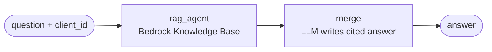

# v1: RAG only

One search agent and one writer. It answers from contract text and nothing else.



## Run

Finish the setup in the [main README](../README.md) first (Knowledge Base created and synced). Then from the project root:

```bash
uv run streamlit run v1_rag_only/app.py
```

Log in as Priya. To test the graph without the UI: `uv run python v1_rag_only/graph.py`.

## The code

All of [graph.py](graph.py) is three things:

- **State:** a `TypedDict`. `Input` is what the app passes in (`question`, `client_id`). `State` adds what the agents fill in (`passages`, `answer`).
- **`rag_agent`:** calls `retrieve()` in [common/kb.py](../common/kb.py). That function builds the client filter itself.
- **`merge`:** puts the passages in a prompt and tells the model to use only them and to cite each contract. If nothing was found, it answers "could not find" without calling the model at all.

The login lives in [common/users.py](../common/users.py). The app reads `client_id` from the session and hands it to the graph. The user never types it.

## Try it

1. "What does the liability clause say in the CloudServe contract?" Works. Open **Passages used** and check the answer against the text.
2. Log out, log in as Arjun, ask the same thing. Different contract, different cap.
3. "Which contracts expire in the next 90 days?" Look at what comes back. It is vague, incomplete or wrong.

## Why question 3 above fails

The Knowledge Base returns the few chunks that sound most like the question. It cannot scan all contracts and compare dates, and the model does not know today's date. Retrieval is for meaning. Dates need a table. That is [v2](../v2_rag_plus_postgres/README.md).

## Think about it

- The prompt says "ONLY the passages". What happens if you remove that?
- Why is `client_id` in the state but never in a prompt?
- The filter runs inside Bedrock, before any text comes back. Why is that safer than filtering the answers afterwards?
