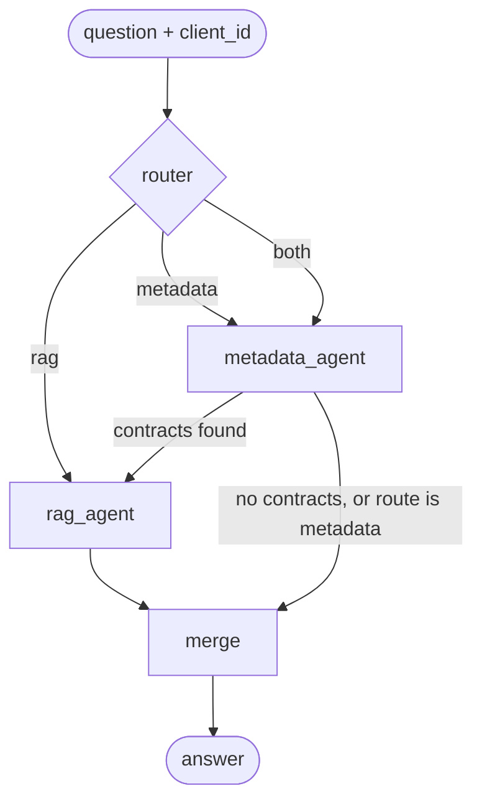

# v2: RAG + Postgres + router

v1 plus a database of exact facts, and a router that decides which agent to use.



## What changed from v1

| New | Where | What it does |
|---|---|---|
| `router` | [graph.py](graph.py) | The LLM answers with one word: `rag`, `metadata` or `both`. Unsure means `both` |
| `metadata_agent` | [graph.py](graph.py) | The LLM picks **one** fixed query and a number of days. Our code runs it |
| Postgres table | [schema.sql](schema.sql), [seed.py](seed.py) | One row per contract: dates, notice days, auto-renew flag, value |
| Fixed queries | [db.py](db.py) | `expiring_within`, `auto_renewing_within`, `find_by_counterparty`, `list_contracts` |
| `merge` | [graph.py](graph.py) | Now gets facts **and** passages: dates from the facts, wording from the passages |
| Trace panel | [app.py](app.py) | Shows the route, the query chosen, the rows, and the passages |

## Run

From the project root, after the setup in the [main README](../README.md):

```bash
docker compose -f v2_rag_plus_postgres/docker-compose.yml up -d
uv run python v2_rag_plus_postgres/seed.py
uv run streamlit run v2_rag_plus_postgres/app.py
```

`seed.py` can be run again at any time. To test the graph without the UI: `uv run python v2_rag_plus_postgres/graph.py`.

## Two design choices worth reading

**1. The LLM does not write SQL.** It chooses from four fixed queries. Our code adds `WHERE client_id = %s` to every one, using the login's `client_id`. Anything the model puts in its reply about the client is ignored. A model that writes free SQL could forget the filter, or be tricked into dropping it.

**2. `both` runs one agent, then the other.** For "auto-renew within 90 days and unlimited liability", Postgres first returns the three contracts that auto-renew soon (NOV-002, NOV-003, NOV-006). The Knowledge Base search is then limited to those three, which is why the clause check stays small and accurate. If Postgres finds nothing, the graph skips the Knowledge Base and says no contracts match.

Compare this with `8_tripadvisor_project`, where agents ran in parallel because none needed another's output.

## Try it

Same table as the [main README](../README.md#things-to-try). In the trace panel, check that:

- "Which contracts expire in the next 90 days?" routes to `metadata` and shows 4 rows.
- A clause question routes to `rag` and shows no rows.
- The Q3 question routes to `both`, and the passages come only from the shortlisted contracts.

## Think about it

- The router can be wrong. What does the user see when it is? Where would you log it?
- Why does `merge` tell the model to say which side the client is on?
- `AS_OF_DATE` is passed to the model and to the queries. What would go wrong if the model used its own idea of today?
- Add a fifth query. Which part of the graph needs to change, and which does not?


## Role of `.metadata.json`

It's a small label file that sits next to each contract in S3. For example, `nov_001_cloudserve.md` gets `nov_001_cloudserve.md.metadata.json`. The Knowledge Base reads it during sync and attaches those values to every chunk of that contract.

Our file holds four fields: `client_id`, `contract_id`, `counterparty` and `contract_type`.

## What it's used for

- **Client isolation (the main job).** `kb.py` sends a filter like `client_id = nova_foods` with every search. Bedrock applies it to the labels before it returns any text. Without the sidecar, there is nothing to filter on, and Priya's search could return Arjun's contracts.
- **Scoping to specific contracts (v2).** After Postgres returns `NOV-003, NOV-006`, the filter `contract_id in [...]` limits the RAG search to those two.
- **Citations.** The retrieve response includes the metadata, so the answer can show `[NOV-001 CloudServe Inc]` instead of a raw S3 path.

## Things to know

- The label is **not** part of the text that gets embedded. It's a separate tag used for filtering, not for meaning.
- The file name must be exactly `<original file name>.metadata.json`, and it must sit in the same S3 folder. Otherwise the KB silently ignores it and the filter returns nothing.
- Changes only take effect after a **sync** (`upload_to_kb.py --sync`). If you edit a label, re-upload and sync again.
- The structure is `{"metadataAttributes": {"client_id": "nova_foods", ...}}`. [upload_to_kb.py](42_course_Sep/06_Langraph/09_law_firm_contract/scripts/upload_to_kb.py) generates these from `sample_data.py`, so you never write them by hand.
- Same idea as the Postgres columns, but for the KB. Both need `client_id`, and in both cases our code sets it, never the LLM.

## Quick check if filtering seems broken

- If every search returns zero results, the sidecar is probably missing or misnamed, or you haven't synced since uploading.
- In the S3 console, confirm each contract has a matching `.metadata.json`.
- Also, I haven't tested this filtering against a real managed KB yet. If you see zero results, tell me and we'll check it first.


They're chosen by you. AWS fixes the file name and the wrapper, and you pick the field names and values.

## Fixed by AWS

- The file name: `<document>.metadata.json`.
- The top-level key `metadataAttributes`.
- The value types: string, number, boolean and string list.
- The 10 KB limit.

## Chosen by us

- The field names, `client_id`, `contract_id`, `counterparty` and `contract_type`. `client_id` could just as well be called `tenant` or `org`.
- The values, which come from [sample_data.py](42_course_Sep/06_Langraph/09_law_firm_contract/common/sample_data.py).

## One rule that ties it together

The field name in the sidecar must match exactly what the filter in [kb.py](42_course_Sep/06_Langraph/09_law_firm_contract/common/kb.py) uses. The sidecar says `client_id`, and the filter says `{"equals": {"key": "client_id", ...}}`. If one is `client_id` and the other is `clientId`, the filter matches nothing and returns zero results. It doesn't error.

## How to choose fields for a real project

- Add a field only if you'll **filter on it**. We filter on `client_id` and `contract_id`.
- `counterparty` and `contract_type` are there for citations and future filters. Keep them or drop them.
- Dates, notice period and amounts are deliberately not in the sidecar. They live in Postgres, because the KB filter can't do date math well and an LLM shouldn't be asked to compare dates.

Ref
- [https://docs.aws.amazon.com/bedrock/latest/userguide/s3-data-source-connector.html](s3 data source connector)    <!-- file link -->
- [https://docs.aws.amazon.com/bedrock/latest/userguide/kb-metadata.html](Improve knowledgebase query)
- [https://docs.aws.amazon.com/bedrock/latest/APIReference/API_agent-runtime_MetadataAttributeSchema.html](Filter not for .metadata.json)
- 


